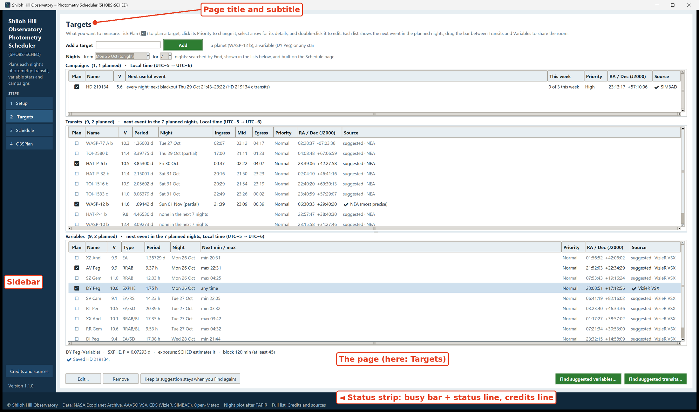

# 1. What SHOBS-SCHED is

SHOBS-SCHED, the Shiloh Hill Observatory Photometry Scheduler, is a desktop program that plans your nights of
**photometry**: exoplanet transits, variable stars, and campaigns (stars or fields you come back to night after
night). It plans tonight (the default) or up to seven nights ahead, prints a plan card you can keep at the telescope, and writes each
night's target list for ASIAIR or NINA.

You do not need to be a programmer to use it. If you know your site, your telescope and your camera, you can plan a
night with it.

## A photometry scheduler, not an imaging planner

SHOBS-SCHED plans for *measuring* stars, not for making pictures of them. That changes what a good plan looks like,
and the program is built around it:

- **Transits need baseline.** A transit is only useful with steady out-of-transit light before ingress and after
  egress, so a transit block runs from well before ingress to well after egress, and the program checks that the whole
  transit happens in the dark and above your limits.
- **Some events happen at a set time.** An eclipsing binary's minimum or an RR Lyrae star's maximum happens when it
  happens. SHOBS-SCHED places these *fixed-time* targets first and fits everything else around them.
- **Exposures must stay linear.** A star whose brightest pixel goes past the camera's linear limit gives bad
  photometry. SHOBS-SCHED estimates an exposure for each target that keeps the peak under your linear limit, and
  warns you when one of your own exposures may saturate.
- **Meridian flips matter.** A flip in the middle of a transit costs frames and changes the star's place on the
  sensor. The planner times flips so that, where it can, the flip happens before the run starts.
- **Campaigns have goals.** A star you follow for weeks gets a goal such as "three nights a week", and the planner
  pushes it up when it falls behind.

What it does **not** do:

- **It does not plan deep-sky imaging.** It has no idea of "hours of integration per filter" on a nebula or galaxy.
  General imaging planners do that job better.
- **It does not run your camera or mount.** It writes a plan; ASIAIR, NINA or your capture program runs the night.
  The ASIAIR and NINA files carry the targets' positions only; times, exposures and notes stay on the plan card.
- **It does not reduce your frames.** That is SHOBS-P's job (below).
- **It needs the internet for lookups and the weather.** Target lookups (NASA Exoplanet Archive, AAVSO VSX, VizieR,
  SIMBAD) and the forecast (Open-Meteo) need a connection. Saved copies are used when a service does not answer, and
  the plan itself is worked out on your computer.

## The window

SHOBS-SCHED has one main window. The blue sidebar on the left reads **Shiloh Hill / Observatory / Photometry /
Scheduler**, with **(SHOBS-SCHED)** under it and the line *Plans each night's photometry: transits, variable stars
and campaigns*. Below that are the four steps, and at the bottom **Credits and sources** and the version number
(**Version 1.1.0**).

The white area on the right is the page you are working on. Every page has its title at the top and a short line
under it saying what the page is for.

Along the bottom runs the **status strip**. Its first line holds the latest news (for example **✔ Setup saved.**);
its second line is a short credits line. While the program is working, a busy bar appears at the lower left of the
status strip; chapter 8 explains it.

SHOBS-SCHED always opens on the Setup page.

## The four pages

You work through the steps in the sidebar from top to bottom. Once Setup is done, you will mostly live on pages 2
to 4.

| Step | Page | What you do there |
|---|---|---|
| 1 | **Setup** | Enter your site, time zone, telescope, camera, mount, limits, horizon and weather source, once. |
| 2 | **Targets** | Keep your list of what you want to measure: Campaigns, Transits and Variables. Tick **Plan** for the ones to schedule. Find suggested transits and variables for the coming nights. |
| 3 | **Schedule** | Build the nights. Each night gets a tab with a night plot, the nightly table, flats and darks, what didn't fit and why, and free time. Mark what happened afterwards. |
| 4 | **OBSPlan** | The plan card on screen. Print it, or send one night at a time to ASIAIR or NINA. |

Every page is covered in Part 2 of this manual.

## Colors

Each target type has its own color, used for its blocks on the night plot, its rows in the nightly table and its
cells on the plan card:

| Type | Color |
|---|---|
| **Transit** | green |
| **Variable** | navy |
| **Campaign** | plum |

Every final action button (**Build schedule**, **Add**, **Print plan card**, **Save** and so on) is green and
dims briefly when you press it. Every message carries an icon as well as a color: **✔** blue for normal news,
**⚠** dark amber on pale yellow for a caution, **✖** red when something did not work.

## The site's clock

Every time SHOBS-SCHED shows is on your **site's** clock, in the site's time zone from the Setup page, whatever
time zone the computer itself is set to. Labels say which clock that is, for example **Local time (UTC−4)**. On a
night when daylight saving starts or ends, the label shows both offsets: **Local time (UTC−4 → UTC−5)**.

This matters if you plan for a remote observatory, or travel with a laptop: the plan always shows the times you
will see on a clock at the telescope.

A "night" is named by the date it starts on. The night of Tuesday 20 October runs from Tuesday evening to Wednesday
morning, and its morning hours (01:00, 04:30) belong to it.

## SHOBS-SCHED and SHOBS-P

SHOBS-SCHED's sister program, [SHOBS-P](https://github.com/SHOBS-S/SHOBS-P), reduces the frames you take: it turns a
night of FITS frames into a light curve or a transit fit. SHOBS-SCHED plans the night; SHOBS-P measures it.

- **SHOBS-SCHED works on its own.** You do not need SHOBS-P installed. Type your site and equipment on the Setup
  page and everything works.
- **When SHOBS-P is installed on the same computer**, SHOBS-SCHED reads SHOBS-P's settings when it starts, so you
  type your site and equipment only once. It reads your latitude, longitude, elevation, time zone, aperture, focal
  length, pixel size, telescope name, linear limit, mount type and observer code. It also takes the limits from
  SHOBS-P's *Tonight's transits* finder (minimum altitude, darkness, and the baseline, brightness and depth filter)
  as starting values, once.
- **It never changes SHOBS-P's files.** Each program owns its own settings.
- **Every Setup value shows where it came from**, with a small gray tag beside the field: *from SHOBS-P*, *from
  FITS* or *set here*. A value you type in SHOBS-SCHED wins over SHOBS-P's from then on. Chapter 4 explains the
  tags.

## How to use this manual

- **Part 1** (chapters 1 to 3) gets you installed and through your first night.
- **Part 2** (chapters 4 to 7) covers each page in turn, every field and button.
- **Part 3** is reference: the busy bar and messages, credits, troubleshooting, and a glossary.

Button names and other words you see on the screen are printed in **bold**, exactly as the program shows them.
Messages are printed in *italics*. Examples use a made-up "Example Observatory" at latitude 40.0° N, longitude
100.0° W, with a 0.25 m telescope.

> **Tip:** If you are in a hurry, go straight to [3. Your first night, step by step](03-first-night.md). It takes you
> from an empty Setup page to a printed plan card.

---

Previous: [Contents](README.md) · Next: [2. Installing and starting](02-installing.md)
