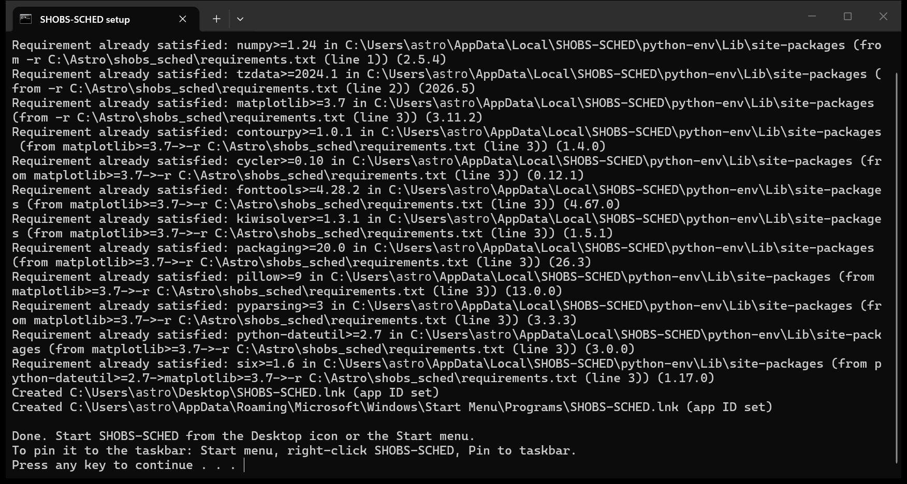
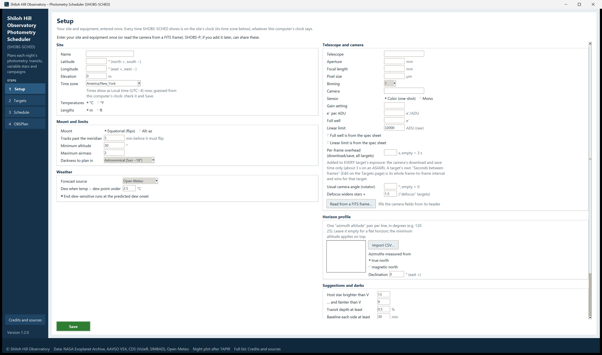

# 2. Installing and starting

SHOBS-SCHED is a Python program. You install Python once, unzip SHOBS-SCHED, and run one file that sets everything
else up. It takes a few minutes, most of it waiting for downloads.

## What you need

- **Windows 10 or 11, Linux, or a Mac.** SHOBS-SCHED comes with start files for all three. The Linux start file
  has been tested on Linux. The Mac start files are new in 1.2.0 and have not yet been tested on a Mac by a user
  (see "Linux and the Mac" below).
- **Python 3.11 or newer, with Tkinter** (the window toolkit). Python from python.org includes it. On Windows,
  Anaconda or Miniconda also works.
- **An internet connection**, for the install and later for target lookups and the weather.

SHOBS-SCHED uses only three packages on top of Python: **NumPy**, **tzdata** (the world's time zones, so your site's
daylight-saving changes are right on every computer) and **Matplotlib** (the night plot). The setup installs them for
you.

## Install Python (Windows)

1. Go to [python.org/downloads](https://www.python.org/downloads/) and download the latest Python for Windows.
2. Run the installer. On the first screen, tick **Add python.exe to PATH**. The SHOBS-SCHED start files find Python
   this way.
3. Click **Install Now** and wait for it to finish.

> **Tip:** If you already have Python 3.11 or newer (for SHOBS-P, for example), you can skip this. SHOBS-SCHED tries
> each Python it finds and uses the first one that works, Tkinter included. Your Python itself is left as it is.

## Install SHOBS-SCHED on Windows

1. Unzip SHOBS-SCHED somewhere permanent, for example `C:\Astro\shobs_sched`. Avoid your Downloads folder: the
   shortcuts point at this folder, so it should not move.
2. Open the folder. It holds files such as `sched_app.py`, `Create shortcuts.bat`, `Run self-test.bat`,
   `run_windows.bat` and `README.md`.
3. Double-click **Create shortcuts.bat**. A black window opens. The first time it:
   - says `Looking for a Python that can run SHOBS-SCHED...` and lists each Python it tries, with `usable:` beside
     the one that works, or `not usable:` and the reason for the others;
   - sets up SHOBS-SCHED's own Python environment in `%LOCALAPPDATA%\SHOBS-SCHED\python-env` (made from that Python,
     which is left untouched);
   - says `Checking the Python packages SHOBS-SCHED needs (the first time this downloads them: a few minutes)...`
     and installs NumPy, tzdata and Matplotlib;
   - makes a **SHOBS-SCHED** icon on the Desktop and in the Start menu.
4. When it says `Done. Start SHOBS-SCHED from the Desktop icon or the Start menu.`, press any key to close the window.

If the window says `SHOBS-SCHED could not find a Python it can use`, every Python it tried is listed above that line
with the reason. Install Python from python.org (tick **Add python.exe to PATH**) and run **Create shortcuts.bat**
again. If it says `The shortcuts could not be made. Leave this window open and copy the message above.`, the lines
above it say why.

> **Tip:** To pin SHOBS-SCHED to the taskbar, open the Start menu, right-click **SHOBS-SCHED** and choose **Pin to
> taskbar**. The pin keeps the SHOBS-SCHED icon (not Python's).

If you ever move the SHOBS-SCHED folder, run **Create shortcuts.bat** again so the shortcuts point at the new place.

## Check the install with the self-test

1. In the SHOBS-SCHED folder, double-click **Run self-test.bat** (on Linux or a Mac, see "Linux and the Mac"
   below).
2. Wait for it to finish. It says `Running the SHOBS-SCHED self-test. It takes under a minute...`; on a slow
   computer the window test can take a little longer. A SHOBS-SCHED window may open and close by itself; that is
   part of the test.
3. The last result line should read `ALL PASSED`.

The test changes none of your settings, targets or schedule: it works in a temporary folder that it deletes at the
end. It checks, in seven sections: your Python and its packages (Matplotlib and time zones included); the sky
arithmetic (dark times, meridian times, transit times) against a known week of plans; the planner; the weather
reader and the exports; the exposure by S/N (new in 1.4.0); the window itself (every page, a build and the ASIAIR list, with the network switched off);
and, for information only, whether the online services and the SIMBAD and VizieR mirrors answer.

Each check is marked `PASS` or `FAIL`. In the last section a service that does not answer is marked `NOTE`, not a
failure: SHOBS-SCHED falls back on its saved copies. The window section says `SKIP` when there is no screen.

The log is written to `selftest_log.txt` in the SHOBS-SCHED folder, and a copy to `SHOBS-SCHED_selftest_log.txt` in
your Downloads folder. If you ever report a problem, attach this file. Chapter 10 has more.

## Start SHOBS-SCHED

Double-click the **SHOBS-SCHED** icon on the Desktop, or choose it from the Start menu. The program opens without a
console window, on the **Setup** page.

The window fills most of the screen. You can resize it or maximize it like any other window.

### Other ways to start

**run_windows.bat** starts SHOBS-SCHED with a black console window beside it, using the same Python as the shortcuts,
and checks the packages first. Use it when the program will not start from its icon: the console shows the error,
and the window stays open with `The app did not start. Leave this window open and copy the message above.`

### Linux and the Mac

SHOBS-SCHED comes with start files for Linux and the Mac. They do the same job as **Create shortcuts.bat** on
Windows: find a Python that can run SHOBS-SCHED, give SHOBS-SCHED its own Python environment, install the packages,
and start the program. They do not make a Desktop icon.

> **Note:** The Linux start file has been tested on Linux. The Mac start files are new and have not yet been tested
> on a Mac by a user. If one does not work for you, please report it (chapter 10).

**Install Python.**

- **Mac:** install Python 3.13 from [python.org/downloads](https://www.python.org/downloads/). When it has
  installed, run **Install Certificates.command** in its folder under Applications (the lookups need it).
- **Linux:** Python 3.11 or newer with Tkinter will do. On Debian or Ubuntu, install Tkinter with
  `sudo apt install python3-tk`.

**Start SHOBS-SCHED.**

1. Unzip SHOBS-SCHED where you want to keep it.
2. Start it:
   - **Mac:** double-click **Start SHOBS-SCHED.command**. The first time, macOS may refuse to open it. Then
     Control-click (or right-click) it, choose **Open**, and **Open** again.
   - **Linux:** in a terminal, in the SHOBS-SCHED folder, type `bash start_linux.sh`.
3. The first time, it says `Setting up SHOBS-SCHED's own Python environment (one time; a few minutes)…`, then
   `Trying` and the path of each Python it tries. A Python that cannot run SHOBS-SCHED is marked `not usable:` with
   the reason. When one works it says `✔ Using` and that Python's path, and SHOBS-SCHED opens. Later starts skip all
   this.

It tries Python 3.13 first, then 3.12, then 3.11, then any newer one. Python 3.13, 3.12 and 3.11 have
ready-made copies of NumPy and Matplotlib, and it never compiles a package: a brand-new Python may have none yet. When the packages will not install on one Python, the next one
is tried, and a line says why (for example `A package has no ready-made copy for this Python and would have to be
compiled. Trying an older Python.`).

If it ends with `✖ No Python on this computer can run SHOBS-SCHED yet.`, install Python 3.13 from python.org (on a
Mac, then run its **Install Certificates.command**) and start again. On the Mac, a window that fails stays open with
`SHOBS-SCHED did not start. Leave this window open and copy the message above.` and names the two logs to send with a
report: `The package install log is ~/Library/Application Support/SHOBS-SCHED/pip_log.txt; the program's own log is
~/.shobs_sched/sched.log.`

The Terminal window stays open while SHOBS-SCHED runs. Leave it open until you have closed SHOBS-SCHED.

**The self-test.** On a Mac, double-click **Run self-test.command**. On Linux, type
`bash start_linux.sh selftest`. It is the same test as on Windows (above); the log goes to `selftest_log.txt` in the
SHOBS-SCHED folder and a copy to `SHOBS-SCHED_selftest_log.txt` in your Downloads folder. On the Mac the window says
so when it is done. If no Python could be set up, the test never ran and there is no log: the window then says
`The self-test did not pass or could not run. Leave this window open and copy the message above.`

Times, settings files and exports work the same way as on Windows. Buttons that open a file or folder use the
system's own opener (`xdg-open` on Linux, `open` on the Mac); **Open in Notepad** opens your default text editor
there.

## Where SHOBS-SCHED keeps your things

Everything you enter is kept in your user folder (`C:\Users\<you>` on Windows, your home folder `~` elsewhere), not
in the program folder, so an update never loses it:

| File or folder | What it holds |
|---|---|
| `.shobs_sched_settings.json` | Setup (site, telescope and camera, mount, limits, horizon, weather, suggestions and darks), the remembered search choices, the ASIAIR export folder and the **Include night plots** tick. |
| `.shobs_sched_targets.json` | Your target list: every Campaign, Transit and Variable, with priorities, ticks, goals, rules and notes. |
| `.shobs_sched\schedule.json` | The saved schedule: every night, its blocks and your Done / Partial / Clouded out marks, plus the history of past nights. |
| `.shobs_sched\cache\` | Saved answers from the online services (lookups, the transit catalog, the forecast) and the latest plan card (`plan_card.html`). |
| `.shobs_sched\sched.log` | The program's log (chapter 10). |

The names start with a dot, so Windows Explorer may hide them. Type `%USERPROFILE%` into the Explorer address bar
and turn on **Hidden items** under **View** to see them.

The Python environment is separate again: it holds only Python and its packages. It is in
`%LOCALAPPDATA%\SHOBS-SCHED` on Windows, `~/Library/Application Support/SHOBS-SCHED` on a Mac, and
`~/.local/share/SHOBS-SCHED` on Linux.

> **Note:** Each file is written in one go (to a temporary file first, then swapped in), so a crash never leaves a
> half-written file. If a file ever cannot be read, SHOBS-SCHED keeps a copy beside it with `.bad` added to its name
> and starts from defaults.

## Updating to a new version

1. Unzip the new version, over the old folder or beside it.
2. On Windows, double-click **Create shortcuts.bat** in the new folder. It points the shortcuts at it and installs
   any new packages the new version needs. The Python environment is shared by every SHOBS-SCHED version, so this is
   quick. On Linux or a Mac, just start the new version with its start file: it checks the packages each time and
   sets the environment up again if one is missing.

Your settings, targets and schedule stay where they are, in your user folder.

---

Previous: [1. What SHOBS-SCHED is](01-what-it-is.md) · Next: [3. Your first night, step by step](03-first-night.md)
