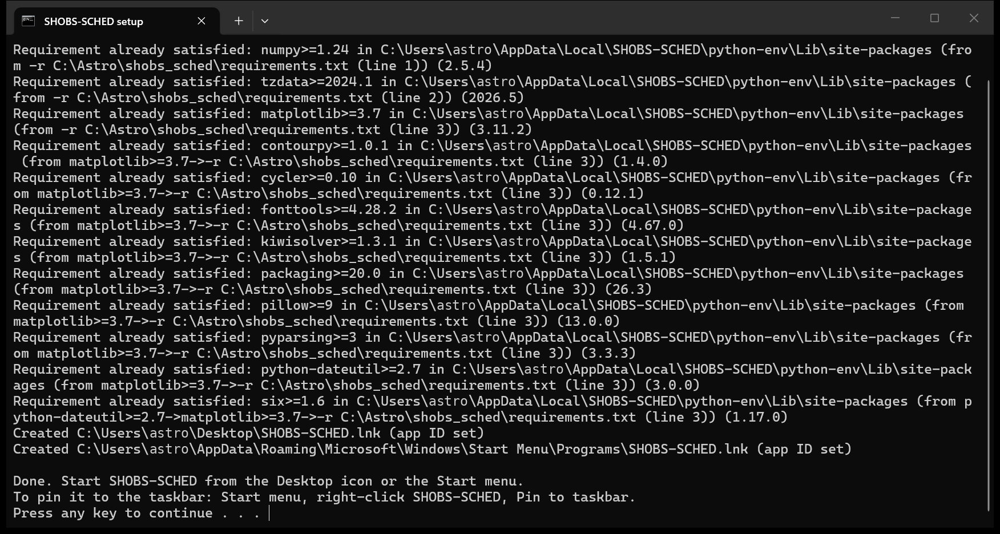
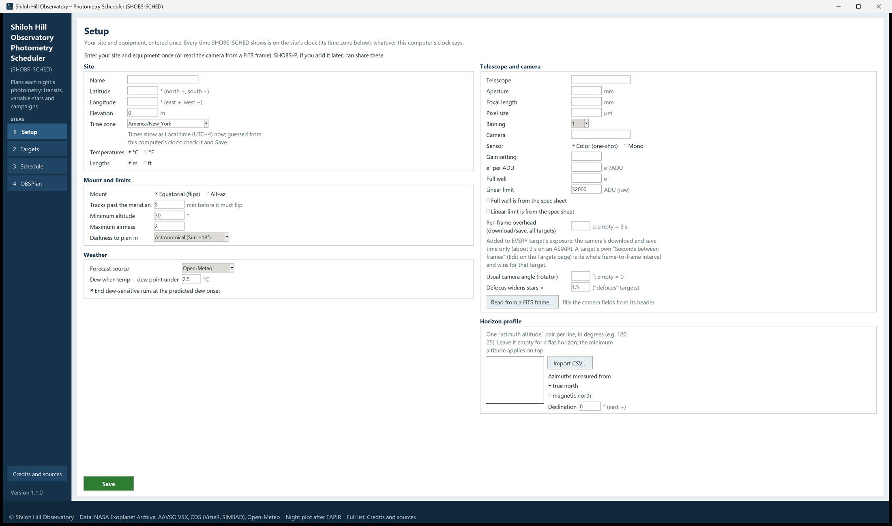

# 2. Installing and starting

SHOBS-SCHED is a Python program. You install Python once, unzip SHOBS-SCHED, and run one file that sets everything
else up. It takes a few minutes, most of it waiting for downloads.

## What you need

- **Windows 10 or 11.** The start files that come with SHOBS-SCHED are for Windows. It also runs on Linux and a Mac,
  started by hand (see "Linux and the Mac" below).
- **Python 3.11 or newer, with Tkinter** (the window toolkit). Python from python.org includes it. Anaconda or
  Miniconda also works.
- **An internet connection**, for the install and later for target lookups and the weather.

SHOBS-SCHED uses only three packages on top of Python: **NumPy**, **tzdata** (the world's time zones, so your site's
daylight-saving changes are right on every computer) and **Matplotlib** (the night plot). The setup installs them for
you.

## Install Python (Windows)

1. Go to [python.org/downloads](https://www.python.org/downloads/) and download the latest Python for Windows.
2. Run the installer. On the first screen, tick **Add python.exe to PATH**. The SHOBS-SCHED start files find Python
   this way.
3. Click **Install Now** and wait for it to finish.

> **Tip:** If you already have Python 3.11 or newer (for SHOBS-P, for example), you can skip this. SHOBS-SCHED tries
> each Python it finds and uses the first one that works, Tkinter included. Your Python itself is left as it is.

## Install SHOBS-SCHED on Windows

1. Unzip SHOBS-SCHED somewhere permanent, for example `C:\Astro\shobs_sched`. Avoid your Downloads folder: the
   shortcuts point at this folder, so it should not move.
2. Open the folder. It holds files such as `sched_app.py`, `Create shortcuts.bat`, `Run self-test.bat`,
   `run_windows.bat` and `README.md`.
3. Double-click **Create shortcuts.bat**. A black window opens. The first time it:
   - says `Looking for a Python that can run SHOBS-SCHED...` and lists each Python it tries, with `usable:` beside
     the one that works, or `not usable:` and the reason for the others;
   - sets up SHOBS-SCHED's own Python environment in `%LOCALAPPDATA%\SHOBS-SCHED\python-env` (made from that Python,
     which is left untouched);
   - says `Checking the Python packages SHOBS-SCHED needs (the first time this downloads them: a few minutes)...`
     and installs NumPy, tzdata and Matplotlib;
   - makes a **SHOBS-SCHED** icon on the Desktop and in the Start menu.
4. When it says `Done. Start SHOBS-SCHED from the Desktop icon or the Start menu.`, press any key to close the window.

If the window says `SHOBS-SCHED could not find a Python it can use`, every Python it tried is listed above that line
with the reason. Install Python from python.org (tick **Add python.exe to PATH**) and run **Create shortcuts.bat**
again. If it says `The shortcuts could not be made. Leave this window open and copy the message above.`, the lines
above it say why.

> **Tip:** To pin SHOBS-SCHED to the taskbar, open the Start menu, right-click **SHOBS-SCHED** and choose **Pin to
> taskbar**. The pin keeps the SHOBS-SCHED icon (not Python's).

If you ever move the SHOBS-SCHED folder, run **Create shortcuts.bat** again so the shortcuts point at the new place.

## Check the install with the self-test

1. In the SHOBS-SCHED folder, double-click **Run self-test.bat**.
2. Wait for it to finish. It says `Running the SHOBS-SCHED self-test. It takes under a minute...`; on a slow
   computer the window test can take a little longer. A SHOBS-SCHED window may open and close by itself; that is
   part of the test.
3. The last result line should read `ALL PASSED`.

The test changes none of your settings, targets or schedule: it works in a temporary folder that it deletes at the
end. It checks, in six sections: your Python and its packages (Matplotlib and time zones included); the sky
arithmetic (dark times, meridian times, transit times) against a known week of plans; the planner; the weather
reader and the exports; the window itself (every page, a build and the ASIAIR list, with the network switched off);
and, for information only, whether the online services answer.

Each check is marked `PASS` or `FAIL`. In the last section a service that does not answer is marked `NOTE`, not a
failure: SHOBS-SCHED falls back on its saved copies. The window section says `SKIP` when there is no screen.

The log is written to `selftest_log.txt` in the SHOBS-SCHED folder, and a copy to `SHOBS-SCHED_selftest_log.txt` in
your Downloads folder. If you ever report a problem, attach this file. Chapter 10 has more.

## Start SHOBS-SCHED

Double-click the **SHOBS-SCHED** icon on the Desktop, or choose it from the Start menu. The program opens without a
console window, on the **Setup** page.

The window fills most of the screen. You can resize it or maximize it like any other window.

### Other ways to start

**run_windows.bat** starts SHOBS-SCHED with a black console window beside it, using the same Python as the shortcuts,
and checks the packages first. Use it when the program will not start from its icon: the console shows the error,
and the window stays open with `The app did not start. Leave this window open and copy the message above.`

### Linux and the Mac

SHOBS-SCHED 1.1.0 comes with Windows start files only, but the program itself runs anywhere Python 3.11+ with Tkinter
does:

1. Install Python 3.11 or newer with Tkinter (on Debian or Ubuntu: `sudo apt install python3-tk`).
2. Install the packages: `python3 -m pip install -r requirements.txt` in the SHOBS-SCHED folder (or install NumPy,
   tzdata and Matplotlib from your package manager).
3. Start it with `python3 sched_app.py` in that folder.
4. Run the self-test with `python3 selftest.py`.

Times, settings files and exports work the same way. Buttons that open a file or folder use the system's own opener
(`xdg-open` on Linux, `open` on the Mac); **Open in Notepad** opens your default text editor there.

## Where SHOBS-SCHED keeps your things

Everything you enter is kept in your user folder (`C:\Users\<you>` on Windows, your home folder `~` elsewhere), not
in the program folder, so an update never loses it:

| File or folder | What it holds |
|---|---|
| `.shobs_sched_settings.json` | Setup (site, telescope and camera, mount, limits, horizon, weather), the remembered search choices, the ASIAIR export folder and the **Include night plots** tick. |
| `.shobs_sched_targets.json` | Your target list: every Campaign, Transit and Variable, with priorities, ticks, goals, rules and notes. |
| `.shobs_sched\schedule.json` | The saved schedule: every night, its blocks and your Done / Partial / Clouded out marks, plus the history of past nights. |
| `.shobs_sched\cache\` | Saved answers from the online services (lookups, the transit catalog, the forecast) and the latest plan card (`plan_card.html`). |
| `.shobs_sched\sched.log` | The program's log (chapter 10). |

The names start with a dot, so Windows Explorer may hide them. Type `%USERPROFILE%` into the Explorer address bar
and turn on **Hidden items** under **View** to see them.

The Python environment in `%LOCALAPPDATA%\SHOBS-SCHED` is separate again: it holds only Python and its packages.

> **Note:** Each file is written in one go (to a temporary file first, then swapped in), so a crash never leaves a
> half-written file. If a file ever cannot be read, SHOBS-SCHED keeps a copy beside it with `.bad` added to its name
> and starts from defaults.

## Updating to a new version

1. Unzip the new version, over the old folder or beside it.
2. Double-click **Create shortcuts.bat** in the new folder. It points the shortcuts at it and installs any new packages
   the new version needs. The Python environment is shared by every SHOBS-SCHED version, so this is quick.

Your settings, targets and schedule stay where they are, in your user folder.

---

Previous: [1. What SHOBS-SCHED is](01-what-it-is.md) · Next: [3. Your first night, step by step](03-first-night.md)
