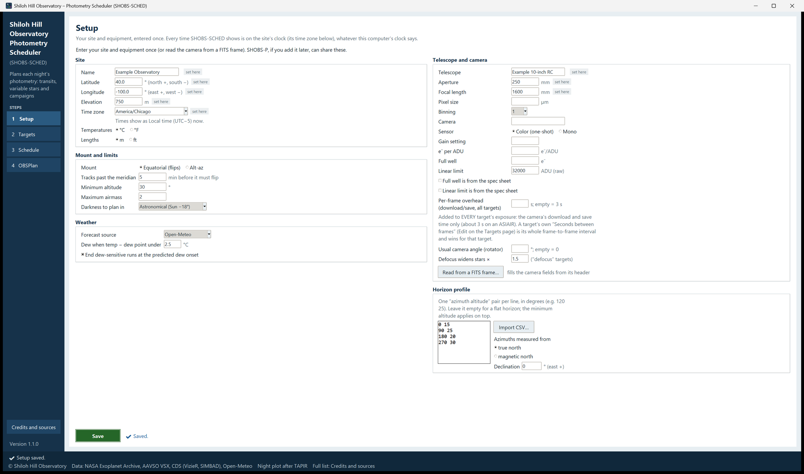
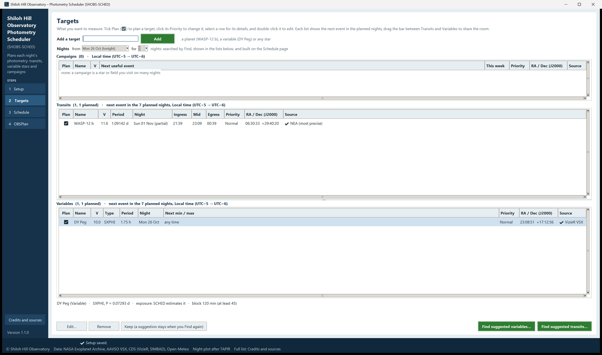
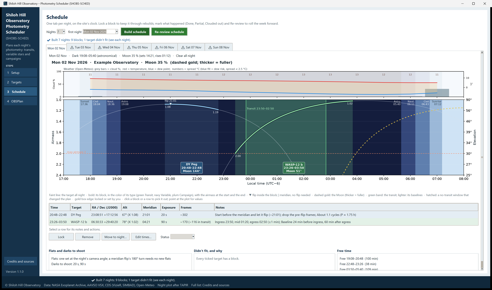

# 3. Your first night, step by step

This chapter takes you from a fresh install to a printed plan and a target list in ASIAIR. It plans one transit and
one variable star. Each step has its own chapter in Part 2 with the details; here we keep to the main road.

The example site is "Example Observatory" at latitude 40.0° N, longitude 100.0° W, with a 0.25 m telescope. Use your
own values.

## Step 1: Setup

SHOBS-SCHED opens on the Setup page. If SHOBS-P is installed on this computer, many fields are already filled and
tagged *from SHOBS-P*; check them and go on.

1. In the **Site** box, type:
   - **Name**: `Example Observatory`
   - **Latitude**: `40.0` (north is positive, south negative)
   - **Longitude**: `-100.0` (east is positive, **west is negative**)
   - **Elevation**: your height above sea level.
2. Check **Time zone**. SHOBS-SCHED guesses it from the computer's clock and says so under the box (*Times show as
   Local time (UTC−5) now; guessed from this computer's clock: check it and Save.*). For our example site pick
   `America/Chicago`. You can type in the box to jump through the list.
3. In **Telescope and camera**, type the **Aperture** (`250` mm), **Focal length** and **Pixel size**. The pixel
   scale appears beside **Binning** (for example *1.24″ per pixel*). If you have a FITS frame from this camera and
   telescope, **Read from a FITS frame…** fills the camera fields for you (chapter 4).
4. Type your camera's **Linear limit** in raw ADU, if you know it. It is the brightness above which your camera stops
   responding in proportion to the light. The planner keeps star peaks under it. If you only have the spec sheet's
   value, tick **Linear limit is from the spec sheet** so the plan marks it as an estimate.
5. In **Mount and limits**, choose **Equatorial (flips)** or **Alt-az**, and check **Minimum altitude** (30° by
   default) and **Darkness to plan in** (astronomical by default).
6. Press the green **Save** button at the bottom. It says **✔ Saved.**

## Step 2: Add a transit and a variable star

1. Click **2 Targets** in the sidebar.
2. In **Add a target** at the top, type `WASP-12 b` and press **Enter** (or click **Add**).
3. The busy bar appears at the lower left of the window, in the status strip, with the words *Looking up WASP-12
   b…*. When it finishes, a result line appears beside the **Add** button, for example *✔ Added WASP-12 b (NEA (most
   precise)).* The planet is in the **Transits** box, ticked to plan (☑).
4. Type `DY Peg` and press **Enter**. It is looked up at AAVSO VSX (or its copy at VizieR, as in the picture) and
   lands in the **Variables** box, also ticked.

Each row shows the target's next event in the planned nights: for a transit, the night and its ingress, mid and egress
times; for a variable, its next timed minimum or maximum, or *any time* for a star with no event worth timing. A
transit marked *(partial)* is only partly in the dark; if a transit shows *none in the next 7 nights*, no part of any
transit is in the dark this week. Pick another planet, or try **Find suggested transits…** (chapter 5).

## Step 3: Build the schedule

1. Click **3 Schedule** in the sidebar.
2. Check **Nights** (1 to 7) and **first night** (tonight by default). These are the same nights the Targets page
   shows; change them on either page.
3. Press **Build schedule**.
4. The busy bar at the lower left says what it is doing, step by step: first *Getting the forecast from
   Open-Meteo…*, then *Building 7 nights…*, then *Working out twilight and Moon times…*. When it is done, *✔ Done* appears beside the button, and the line under
   it says what was built, for example *✔ Built 7 nights: 9 blocks; 1 target didn't fit (see each night).*

Each night gets a tab, named by its date (for example **Mon 02 Nov**). A **⚠** in front of a tab's name means that
night has a caution or a target that didn't fit.

5. Click the tab of the night you want to observe. You see:
   - a line with the dark hours, the Moon and the weather summary;
   - the **night plot**: each target's airmass through the night, its block in bold, twilight shading, the Moon, and
     the hourly weather above;
   - the **nightly table**: one row per block, with the time, target, position (RA / Dec), altitude, meridian time,
     exposure, frames and notes;
   - under it, **Flats and darks to shoot**, **Didn't fit, and why**, and **Free time**.

Click a row (or a block on the plot) to pick it out. Read the notes: they say, for example, *Ingress 23:50, mid
01:20, egress 02:50 (±1 min)* and *Start before the meridian and let it flip (~21:01); drop the pre-flip frames*.

## Step 4: Print the plan card

1. Click **4 OBSPlan** in the sidebar. The plan card for the ticked nights is on screen.
2. Under **Nights**, tick only the night you will observe (all coming nights are ticked at first).
3. Leave **Include night plots** ticked if you want the plot on the card.
4. Press **Print plan card**. The card opens in your web browser. Print it from there (in most browsers, **Ctrl+P**).

The card is black on white with big times, so you can read it at the telescope by red light.

## Step 5: Send the night to ASIAIR

1. On the OBSPlan page, find the night's heading on the card. Beside it are **Export to ASIAIR**, **Export to NINA**
   and **Copy ASIAIR list**.
2. Press **Export to ASIAIR**. A line under the heading says where the file went, for example *✔ ASIAIR: saved 2
   targets for Mon 02 Nov to C:\Users\you\Downloads\SHOBS-SCHED_ASIAIR_2026-11-02.csv. In ASIAIR's Plan: Add →
   Import, and paste the file's text.*
3. Open the file (**Open in Notepad**), copy its text, and in ASIAIR's **Plan**, choose **Add → Import** and paste.

ASIAIR takes the targets' positions, in time order. The times, exposures and notes are on your plan card.

> **Tip:** On the OBSPlan page, **Choose folder…** can send the ASIAIR files to a folder that syncs to the phone or
> tablet that runs ASIAIR (iCloud Drive, OneDrive). Then the file is waiting there.

## Step 6: The morning after

1. Open the Schedule page and the night's tab.
2. Click each row and set its **Status**: **Done**, **Partial** or **Clouded out**.
3. When the week moves on, press **Re-review schedule**. The past nights go into the history, the schedule rolls
   forward to tonight, and targets that were clouded out or only partly observed go back into the pool to be
   planned again.

That is the whole cycle. Chapters 4 to 7 cover every page in detail.

---

Previous: [2. Installing and starting](02-installing.md) · Next: [4. Setup](04-setup.md)
