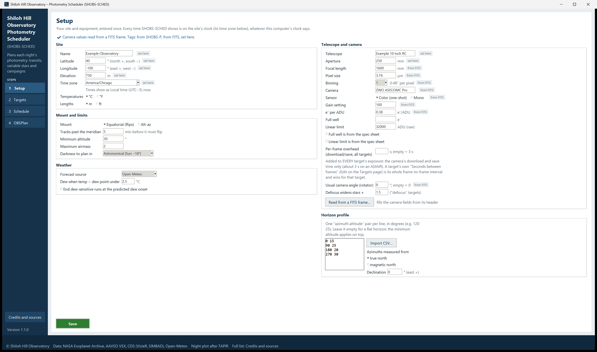
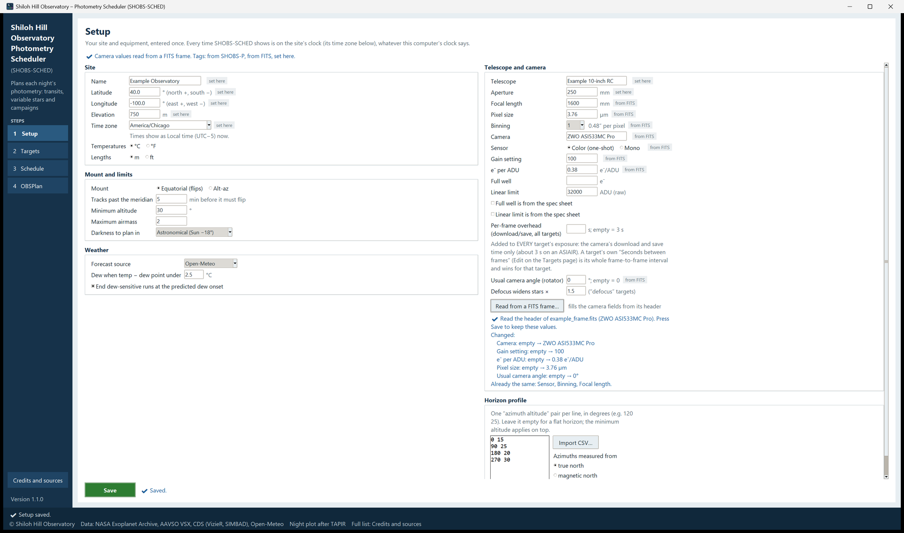

# 4. Setup

The Setup page holds your site and equipment. You fill it in once; after that you come back only when something
changes (a new camera, a new horizon survey). Every plan, every time and every exposure estimate depends on it, so
it is worth getting right.

The page subtitle says it plainly: *Your site and equipment, entered once. Every time SHOBS-SCHED shows is on the
site's clock (its time zone below), whatever this computer's clock says.*

This chapter covers:

- the line at the top (where the values came from) and the source tags,
- the Site box, including the time zone,
- the Telescope and camera box, including **Read from a FITS frame…**,
- the Mount and limits box (meridian flips, minimum altitude, airmass, darkness),
- the Horizon profile box,
- the Weather box (forecast source and dew),
- saving, and leaving the page with unsaved changes,
- the planner settings that are not on the page.

The boxes sit in two columns when the window is wide enough, and in one column otherwise. The page scrolls when it
does not fit.

## Where the values came from

The line at the top of the page says where the values on the page came from:

- With nothing filled in yet: *Enter your site and equipment once (or read the camera from a FITS frame). SHOBS-P,
  if you add it later, can share these.*
- When values came from SHOBS-P or a FITS frame, a **✔** line says so, for example *✔ Site and telescope read from
  SHOBS-P (settings of 2026-10-20). Change them there, or override here. Camera values read from a FITS frame. Tags:
  from SHOBS-P, from FITS, set here.*
- When SHOBS-P's *Tonight's transits* finder gave SHOBS-SCHED its first limits, the line adds: *The minimum altitude,
  darkness and the Suggested-transits filter started from SHOBS-P's Tonight's-transits finder (once; later changes
  there do not move them).*

Beside many fields, a small gray **tag** says where that one value came from:

| Tag | Meaning |
|---|---|
| *from SHOBS-P* | Read from SHOBS-P's settings. It follows SHOBS-P: change it in SHOBS-P and SHOBS-SCHED picks up the new value next time it starts. |
| *from FITS* | Read from a FITS frame with **Read from a FITS frame…**. SHOBS-P's value no longer replaces it. |
| *set here* | You typed it on this page. It is yours, and SHOBS-P never overwrites it. |
| (no tag) | The default, or nothing entered yet. |

The tag changes as soon as you type: a value you change shows *set here* at once. If you type a field back to exactly
SHOBS-P's value and save, it follows SHOBS-P again.

> **Note:** The minimum altitude, the darkness and the suggested-transits filter are taken from SHOBS-P's finder only
> **once**, and only while SHOBS-SCHED still has its own default there. After that, changing them in SHOBS-P does
> not move them here. This stops a later change in one program from quietly changing your plans in the other.

## Site

| Field | What to type |
|---|---|
| **Name** | Your observatory's name. It is printed on the plan card. Optional. |
| **Latitude** | Degrees, north positive, south negative (e.g. `40.0`). Required. |
| **Longitude** | Degrees, **east positive, west negative** (e.g. `-100.0` for 100° W). Required. |
| **Elevation** | Height above sea level, in meters or feet (see **Lengths**). Optional; it fine-tunes the sky noise estimate. |
| **Time zone** | Your site's time zone, by its standard name (`America/Chicago`, `Europe/London`, `Australia/Sydney`). Required. |
| **Temperatures** | **°C** or **°F**, for the weather and the dew setting. Display only. |
| **Lengths** | **m** or **ft**, for the elevation (and wind in km/h or mph). Display only. |

### The time zone

Pick your site's zone from the drop-down list, or type its name. Under the box a line says what every time will read
as, for example *Times show as Local time (UTC−5) now.* When SHOBS-SCHED had to guess the zone from the computer's
clock (first start, nothing saved yet), the line adds *guessed from this computer's clock: check it and Save.* A
name the program does not know gives *Not a zone name: pick one from the list.*

Why this matters: every time in SHOBS-SCHED (dark times, ingress, meridian, block starts) is shown on the site's
clock in this zone, with the daylight-saving changes of that zone. The computer's own time zone is never used. A
remote observatory in another zone, or a laptop that travels, still gets the times a clock at the telescope shows.

## Telescope and camera

| Field | What it is | Why SHOBS-SCHED needs it |
|---|---|---|
| **Telescope** | Its name. | Shown for your reference. |
| **Aperture** | Mirror or lens diameter, mm. | Light collected: the exposure estimate. |
| **Focal length** | mm. | With the pixel size, the pixel scale. |
| **Pixel size** | µm, unbinned. | Pixel scale. |
| **Binning** | 1 to 4. The pixel scale appears beside it (e.g. *1.24″ per pixel*). | Pixel scale. |
| **Camera** | The camera's name (e.g. its model). | Also sets the field of view written to the ASIAIR and NINA lists, for the common ZWO sensors. |
| **Sensor** | **Color (one-shot)** or **Mono**. | A color camera's green pixels see less light than an unfiltered mono pixel. |
| **Gain setting** | The gain you shoot at (as in the FITS GAIN keyword). | Your reference, next to the e⁻ per ADU that goes with it. |
| **e⁻ per ADU** | Electrons per count at that gain. | Turns the predicted electrons into ADU for the peak estimate. |
| **Full well** | Electrons. | Used for e⁻ per ADU when that is empty. |
| **Linear limit** | Raw ADU a star's peak should stay under (32000 if empty). | The exposure estimate keeps peaks under it. |

Two ticks under these say whether a value is from the spec sheet rather than measured: **Full well is from the spec
sheet** and **Linear limit is from the spec sheet**. A ticked one shows **⚠ estimate** beside it.

Why the linear limit matters for photometry: above a certain level, a camera's pixels stop responding in proportion
to the light, long before they saturate. A star whose peak goes past that level is measured too faint. SHOBS-SCHED
picks each target's exposure so that the predicted peak stays at about 80 % of your linear limit, and warns you when
your own exposure may go over. Your own measured value (from a linearity test in SHOBS-P, for example) is better than
the spec sheet's.

Three more fields:

- **Per-frame overhead (download/save, all targets)**: seconds added to every target's exposure for the camera's
  download and save time (*s; empty = 3 s*). About 3 s on an ASIAIR. The planner uses it to count frames. A target's
  own **Seconds between frames** (in its Edit dialog, chapter 5) is the whole frame-to-frame interval and wins for
  that target.
- **Usual camera angle (rotator)**: the angle your camera usually sits at, in degrees (*empty = 0*). It is written to
  the ASIAIR and NINA lists as the position angle, so the plan frames the field the way your flats were taken
  (chapter 7).
- **Defocus widens stars ×**: how much wider a star gets when you defocus (1.5 by default). It applies to targets
  whose notes contain the word "defocus" (chapter 5), so their exposure estimate allows for the spread-out light.

### Read from a FITS frame

If you have a frame taken with this camera and telescope, let SHOBS-SCHED read the values from it:

1. Press **Read from a FITS frame…** at the bottom of the box.
2. Choose a FITS file (`.fits`, `.fit` or `.fts`). Only its header is read, so even a large frame is quick.
3. A summary appears under the button: which values changed (old → new), which were already the same, and which the
   frame does not have. It starts with **✔**, or **⚠** when some keywords were missing.
4. Press **Save** to keep the values.

| Setup field | FITS keyword |
|---|---|
| **Camera** | INSTRUME |
| **Sensor** | BAYERPAT (a pattern such as RGGB means color; NONE or MONO means mono; no keyword leaves it as it is) |
| **Gain setting** | GAIN |
| **e⁻ per ADU** | EGAIN |
| **Pixel size** | XPIXSZ (divided by XBINNING, since XPIXSZ is the binned pixel) |
| **Binning** | XBINNING |
| **Focal length** | FOCALLEN |
| **Usual camera angle** | ROTATOR (taken modulo 180°: 210° and 30° frame the field the same way, on the other pier side) |

The TELESCOP keyword is not used: ASIAIR writes the mount driver's name there, not the telescope's.

Values read from a frame are tagged *from FITS* and win over SHOBS-P's. Type over one and it becomes *set here*.

## Mount and limits

| Field | What it is |
|---|---|
| **Mount** | **Equatorial (flips)** for a German equatorial mount that makes meridian flips, or **Alt-az**. |
| **Tracks past the meridian** | How many minutes your equatorial mount can track past the meridian before it must flip (5 by default). |
| **Minimum altitude** | Degrees. No block is planned below it. 30° by default. |
| **Maximum airmass** | No block is planned at a higher airmass. 2.0 by default (about 30° altitude). |
| **Darkness to plan in** | **Astronomical (Sun −18°)** or **Nautical (Sun −12°)**. |

### Meridian flips

On an equatorial mount, a target crossing the meridian makes the mount flip to the other side of the pier. A flip
costs a few minutes (slew, plate solve, guiding restarts), turns the field on the sensor by 180°, and moves the star to
other pixels, which is unwelcome in the middle of a transit.

SHOBS-SCHED plans around this:

- **It never starts a block within an hour after its target's meridian.** The start moves to about 12 minutes
  *before* the meridian instead, so the mount flips right at the start, while you are there, and the whole run is on
  one side of the pier. The note says *Start before the meridian and let it flip (~22:40); drop the pre-flip frames*.
- **A block that ends just past the meridian** but inside your **Tracks past the meridian** margin needs no flip at
  all. The note says, for example, *Ends 3 min past its meridian, inside your tracking margin; stop by 03:38 at the
  latest*.
- **A flip in the middle of a block** is noted (*Meridian flip at ~01:10; drop the frames during the flip*), and a
  flip during a transit gets a caution: *⚠ Meridian flip during the transit (23:05)*.
- **The flip costs time.** The frame count of a block with a flip allows for a few minutes of lost time.

Set **Tracks past the meridian** to what your mount really does (in ASIAIR this is its meridian-flip setting). A
generous margin lets more blocks finish without a flip.

On an **Alt-az** mount there are no flips. Instead, a target that passes higher than 85° gets *⚠ Zenith keyhole*
with the time: an alt-az mount cannot track smoothly through the zenith.

Southern sites work the same way: flips follow the target's hour angle, wherever the meridian is.

### Limits

A target is "up" when it is above **Minimum altitude**, below **Maximum airmass**, and above your horizon profile
(below). All three apply at once.

Why limits matter for photometry: low stars are seen through more atmosphere. They are fainter, redder and twinkle
more, and the extinction changes quickly as they sink. A transit observed from 25° altitude down to 15° has a sloping
baseline that is hard to fit. Keep the minimum altitude where your data is still good.

### Darkness

**Astronomical (Sun −18°)** is the default: the planning darkness runs from astronomical dusk to dawn. On short
summer nights, or at high latitudes where the Sun never gets 18° below the horizon, choose **Nautical (Sun −12°)**
to plan in what darkness there is. The night tab says when there is no dark time at your chosen level.

Transit baselines may run into nautical twilight even when you plan in astronomical darkness: the transit itself
(ingress to egress) must be in the dark, but the out-of-transit stretches can start a little earlier and end a little
later.

If SHOBS-P's finder used another darkness (for example Sun −15°), that value appears in the drop-down too.

## Horizon profile

If trees or buildings block part of your sky, give SHOBS-SCHED your horizon:

- Type one `azimuth altitude` pair per line, in degrees, for example `120 25` (at azimuth 120°, the horizon is at 25°
  altitude). Commas or semicolons between the numbers work too, and anything after a `#` on a line is ignored.
- Or press **Import CSV…** and choose a CSV or text file with azimuth and altitude columns. Lines that are not two
  numbers are skipped. The message says how many points were read; press **Save** to keep them.
- Leave the box empty for a flat horizon. The minimum altitude always applies on top.

Azimuths run from 0 to 360 (north 0, east 90); altitudes from −5 to 90. Under **Azimuths measured from**, choose
**true north**, or **magnetic north** if your survey was made with a compass; then type your **Declination** (the
magnetic declination, east positive) so the profile is turned to true north.

## Weather

| Field | What it does |
|---|---|
| **Forecast source** | Where the forecast comes from. In 1.1.0 the only source is **Open-Meteo** (free, no account). |
| **Dew when temp − dew point under** | The dew threshold: dew is expected from the first moment in the dark when the air temperature is less than this many degrees above the dew point. 2.5 °C by default. |
| **End dew-sensitive runs at the predicted dew onset** | When ticked (the default), flexible blocks (campaigns and any-time variables) end when dew is expected. Fixed-time blocks are not cut; they get a ⚠ instead. |

The forecast is fetched each time you build a schedule (chapter 6). It covers up to 16 days ahead, and is fetched
again when the saved one is more than three hours old.

## Saving

Press the green **Save** button at the bottom. It says **✔ Saved.**, and the status strip says **✔ Setup saved.**

If a value is wrong, nothing is saved and the line says why, for example *✖ Not saved: Longitude must be between
−180 and 180 (degrees, east positive, west negative).* When several values are wrong, it shows the first and says how
many more there are.

**Leaving the page with unsaved changes.** If you go to another page (or close the window) with valid changes, they
are saved for you, and the status strip says *✔ Setup saved: you left the page with changes, so they were kept.* If
the changes cannot be saved, SHOBS-SCHED asks whether to drop them.

**Changing Setup after a schedule was built.** The schedule was worked out with the old values. The Schedule and
OBSPlan pages then show a ⚠ line asking you to build again (chapter 6).

## Planner settings that are not on the page

A few settings have sensible defaults and no field on the Setup page. They are kept in
`.shobs_sched_settings.json`, in the `options` section, and you rarely need to change them. Close SHOBS-SCHED before
editing the file by hand.

| Setting | Default | What it does |
|---|---|---|
| `baseline_min` | 60 | Minutes of baseline wanted before ingress and after egress of a planned transit. |
| `baseline_trim_min` | 20 | The shortest baseline a side when a transit has to share the night with another fixed target. |
| `overhead_slew_min` | 3 | Minutes between blocks for slew, settle and plate solve. |
| `overhead_focus_min` | 5 | Minutes for autofocus at the start of the night, and after a defocused block. |
| `flip_lead_min` | 12 | How long before the meridian a block starts so the mount flips at the start. |
| `flip_settle_min` | 4 | Minutes lost to a flip. |
| `min_gap_report_min` | 15 | Free gaps shorter than this are not listed. |
| `suggest_vmin`, `suggest_vmax` | 9, 13 | The V range for **Find suggested transits…** (and the starting V range for variables). |
| `suggest_min_depth` | 0.005 | The shallowest suggested transit (0.005 = 0.5 %). |
| `suggest_baseline_min` | 30 | Baseline each side that a suggested transit must have in the dark and above your limits. |
| `suggest_moon_penalty_max` | 3.0 | How much the Moon may brighten the sky (in magnitudes) for a suggestion. |
| `tc_sigma_warn_min` | 10 | A transit whose predicted mid-time uncertainty is larger than this many minutes gets a ⚠. |
| `fwhm_arcsec` | 3.0 | Typical seeing (star width), for the exposure estimate. |
| `target_peak_frac` | 0.8 | The exposure estimate aims the star's peak at this fraction of the linear limit. |
| `darks_on_hand` | (none) | A list of exposures (in seconds) you already have darks for; the night's **Darks to shoot** leaves them out. |

When SHOBS-P's finder seeded these limits, the minimum altitude, darkness and the `suggest_…` filter came from there
(once), as the line at the top of the page says.

---

Previous: [3. Your first night, step by step](03-first-night.md) · Next: [5. Targets](05-targets.md)
