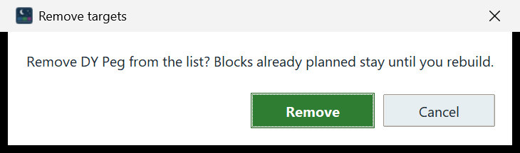
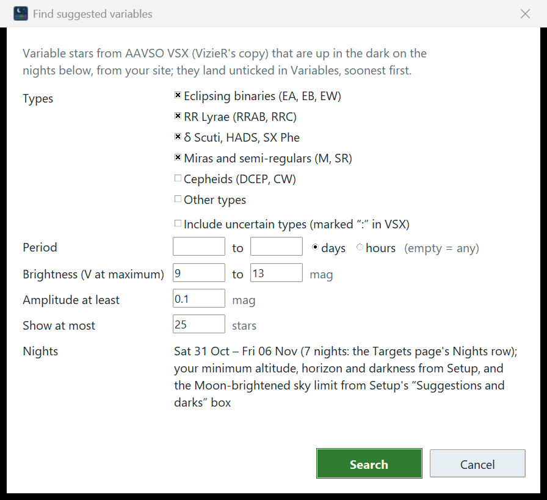

# 5. Targets

The Targets page is your list of what you want to measure. You add targets by name, tick the ones to plan, and let
SHOBS-SCHED suggest more for the coming nights.

Its subtitle reads: *What you want to measure. Tick Plan (☑) to plan a target, click its Priority to change it,
select a row for its details, and double-click it to edit. Each list shows the next event in the planned nights;
drag the bar between Transits and Variables to share the room.*

This chapter covers:

- the three boxes (Campaigns, Transits, Variables) and their columns, including the **Verdict**,
- the **Nights** row,
- adding a target by name, and what happens with stars that are not a planet or a known variable,
- **Plan**, **Priority**, **Keep**, **Edit…** and **Remove**,
- the Edit dialog, including the **Exposure** section (Best precision, Longest safe or your own exposure, the S/N
  and its verdict), a star's known planets and no-transit windows,
- how SHOBS-SCHED works out the S/N, with a worked example,
- **Find suggested transits…** and **Find suggested variables…**,
- ephemeris precision, and how SHOBS-SCHED upgrades it for you.

## The three boxes

Targets sit in three boxes, by type. Each box has its own scroll bars, and the mouse wheel scrolls the box under the
pointer.

| Box | What goes in it | How it is planned |
|---|---|---|
| **Campaigns** | Stars or fields you visit on many nights: a long-running variable star program, a star field you monitor, a planet host you watch between transits. | A flexible block at the best part of the night, with an optional weekly goal and its own rules. |
| **Transits** | Transiting exoplanets with an ephemeris. | At the transit's time, with baseline before and after. |
| **Variables** | Variable stars from AAVSO VSX. | Eclipsing binaries at their timed minima; pulsators and long-period stars as flexible blocks at any time of night. |

Campaigns is a short box on top. Transits and Variables share the rest of the page; drag the bar between them to give
one more room.

Each box's title says how many targets it holds and how many are ticked to plan, and which clock the times are on,
for example **Transits (9, 2 planned) · next event in the 7 planned nights, Local time (UTC−5 → UTC−6)** (the
arrow appears when the clocks change during the planned nights). An empty box shows a
hint, such as *none yet: Add a planet, or press Find suggested transits*.

### The columns

Every box starts with **Plan** (☑ or ☐), **Name** and **V** (the star's V magnitude; for a variable, its brightest).
The others depend on the box:

| Box | Columns |
|---|---|
| **Campaigns** | **Type**, **Period**, **Next useful event**, **This week**, **Verdict**, **Priority**, **RA / Dec (J2000)**, **Source** |
| **Transits** | **Period**, **Night**, **Ingress**, **Mid**, **Egress**, **Verdict**, **Priority**, **RA / Dec (J2000)**, **Source** |
| **Variables** | **Type**, **Period**, **Night**, **Next min / max**, **Verdict**, **Priority**, **RA / Dec (J2000)**, **Source** |

Periods under a day are shown in hours (*5.31 h*), longer ones in days (*3.52490 d*).

A campaign's **Type** and **Period** are the star's VSX type and period (new in 1.4.0). They are kept when you move a
variable star to Campaigns. A campaign that is not a known variable shows **—** in both.

### The Verdict column

New in 1.4.0. **Verdict** says whether your telescope and camera can measure the target, in one word:

| Verdict | Means |
|---|---|
| **Detectable** (green) | S/N 10 or more: the transit, or the star's light changes, will show clearly. |
| **Marginal** (yellow) | S/N 5 to 10: it will show, but only just. A good night helps. |
| **Out of reach** | S/N under 5: lost in the noise with your telescope. |
| **Saturates** | The star's predicted peak is over your linear limit at this exposure, whatever the S/N. Shorten the exposure or defocus. |
| **—** | Nothing to judge: the target has no V magnitude, or a variable or campaign has no VSX range. |

A word with a **?** (*Detectable?*, *Marginal?*, *Out of reach?*, *Saturates?*) is a **rough estimate**: there is no
measured zero point for your system yet (Setup's **Photometry noise** box, chapter 4), so the word is a guess. It
uses the same S/N limits.

The verdict is worked out with the target's exposure, at the target's best airmass from your site, under a dark sky
(no Moon). A suggested transit's verdict is for its own night instead (that night's airmass and Moon). The Schedule
page works it out again for each night (chapter 6). How the S/N is worked out is explained under "How SHOBS-SCHED
works out the S/N" below.

### The next event in the planned nights

The event columns show each target's **first useful event in the planned nights** (the **Nights** row, below), on the
site's clock. They are worked out in the background after the page opens; until then they show **…**.

- **Transits**: the night, ingress, mid-transit and egress of the first transit that happens entirely in the dark
  with the star above your limits. If only part of a transit is visible, the night says **(partial)**. If none falls
  in the planned nights: *none in the next 7 nights* (or *none tonight* for one night).
- **Variables**: the night and the time of the next timed event, for example **min 01:14** (an eclipsing binary's
  minimum) or **max 22:05**. A star with no timed event shows **any time** on the first night it is up long enough.
  A suggested star whose published elements are too old to give a good time shows **any time ⚠ time uncertain ±45
  min** (or **⚠ no usable timing**); a short pulsator suggested for a whole cycle shows **any time (a whole cycle)**.
- **Campaigns**: **every night**, or, for a campaign with a no-transit window, *every night; next blackout Wed 04 Nov
  21:43–23:22 (HD 219134 c transits)*. The blackout is looked for from dusk on the first planned night to the end of
  the last one, so with **Nights** from Mon 02 Nov it never names an earlier day.

Days are written the same way everywhere in SHOBS-SCHED, on the Targets page and in the plan: weekday, day, month,
as in **Wed 04 Nov**.

The rows are sorted by these events: Transits soonest transit first; Variables night by night, with each night's
timed minima and maxima first, then its any-time stars; Campaigns by name. Rows with no event in the planned nights
come last. A row stays in its place when you tick or untick it.

### The Source column

**Source** says where the target came from: **✔ NEA** or **✔ NEA (most precise)** (the NASA Exoplanet Archive; the
second when a more precise published ephemeris than the Archive's default was chosen), **✔ VSX** or **✔ VizieR VSX**
(AAVSO VSX, directly or through VizieR's copy), **✔ SIMBAD**, **✔ NASA Exoplanet Archive** (a star whose position
came from the Archive, see "Add a target by name"), or **typed**. A suggestion shows *suggested · NEA* or
*suggested · VizieR VSX* until you tick it or press **Keep**; then it shows **✔ NEA** or **✔ VizieR VSX**. A transit
found with a Priority list (see "Find suggested transits") adds its priority, for example *suggested · NEA · ExoClock
high, SG1 2*; a TESS candidate that is not yet in the Archive shows *suggested · ExoFOP · SG1 1* (or *· ExoClock* for
a planet only ExoClock lists). A transit whose predicted mid-time is uncertain by more than 10 minutes adds a **⚠ Tc ±**
note (see "Ephemeris precision" below).

### Details of the selected target

Click a row to see its details on a line under the boxes: for a transit, its depth, duration, period, the predicted
mid-time uncertainty (*Tc ± 1.4 min*) and where the ephemeris came from; for a variable, its type and period; for a
campaign, its rules, goal and progress; and for every target, how its exposure is chosen (*exposure: Best precision
(by S/N)*, *exposure: Longest safe*, or *exposure 60 s (yours)*), its verdict with the reason, its block length and
notes. A suggestion also shows its score.

The verdict part reads, for example, *Detectable? (at its best airmass, dark sky): S/N ~58 (rough estimate, no
measured zero point): a 1.47 % dip against 1.1 ppt per 10-min bin, 18 bins in transit*. A suggestion's says *(on its
night)* instead.

## The Nights row

Under **Add a target** is the **Nights** row: **from** (tonight, or any of the next 13 nights) **for** (1 to 7
nights; 1, tonight only, at first). The hint beside it says these nights are *searched by Find, shown in the lists
below, and built on the Schedule page*. These are the nights that:

- the event columns look at,
- **Find suggested transits…** and **Find suggested variables…** search,
- the Schedule page builds.

The Schedule page has the same two controls; changing them on either page changes both. The number of nights is
remembered between sessions; the first night goes back to tonight each time you start the program.

## Add a target by name

1. Type a name in **Add a target**: a planet (`WASP-12 b`, `TrES-3b`, `toi 2046 b`), a variable star (`DY Peg`,
   `V0404 Lyr`) or any star SIMBAD (or the NASA Exoplanet Archive) knows.
2. Press **Enter** or click **Add**.
3. The busy bar at the lower left says *Looking up DY Peg…*. When it is done, a result line beside **Add** says
   *✔ Added DY Peg (VSX).* For a planet it names the source and the ephemeris in one bracket, for example
   *✔ Added WASP-12 b (NEA, most precise).*

The new target is ticked to plan, selected, and its details are shown.

How the name is looked up:

1. **A planet name** (or a star the NASA Exoplanet Archive knows as a planet host) is looked up at the **NASA
   Exoplanet Archive**. You get the planet's position, V, depth, duration and the most precise published ephemeris.
   Spellings are forgiving: `wasp-12b`, `WASP 12 b` and `WASP-12 b` all work.
2. Otherwise, a **variable star** is looked up at **AAVSO VSX**, or VizieR's copy of it when VSX does not answer. You
   get its type, period, epoch and range. Eclipsing binaries are planned at their minima (each minimum covered ±60
   minutes, or ±0.6 × the eclipse length when VSX gives it, between ±20 and ±240 minutes); pulsating and long-period
   stars are planned at any time of night.
3. Otherwise, the star's position is looked up at **SIMBAD**, and a window asks what the star is for you (below).
   SHOBS-SCHED asks SIMBAD at the CDS (Strasbourg) first, then its mirror at IDIA (Cape Town) when the CDS does not
   answer. When SIMBAD does not answer at all, or does not know the name, a planet host's position is taken from
   the **NASA Exoplanet Archive** instead. This also works with a planet's name: `V1298 Tau d` gives its star,
   V1298 Tau. A star added this way shows **✔ NASA Exoplanet Archive** as its Source, and the result line says where
   the position came from with a ⚠, for example *⚠ Added V1298 Tau (NASA Exoplanet Archive). Position from the NASA
   Exoplanet Archive (SIMBAD did not answer).* When the position is already known and only the star's planets are
   still to be looked up, the busy bar says *Looking up V1298 Tau's known planets…* instead of *Looking up the star
   V1298 Tau…*.

Some results need a word from you:

- **A star with several planets.** Typing a host star (for example `HD 219134`) asks *"HD 219134 has more than one
  planet. Add one of them as a transit target, or the star itself (for example a campaign that keeps clear of the
  planets' transits)?"* Pick a planet, or **The star itself (a campaign or a variable)**. Planets that do not transit
  are left out of the choice and named in the question.
- **A star that is not a planet or a known variable.** A window asks **What kind of target?**, with the choices
  **Campaign (a star you visit on many nights)**, **Variable star** and **Star field (a campaign)**, plus **Transit
  target (type its ephemeris later)** when the star has no known planets. If the star has transiting planets, they are
  offered too, and a campaign or variable
  made from the star gets "no data while … transits" for each of them straight away.
- **A planet that does not transit** is never added as an empty transit target. SHOBS-SCHED offers its star instead.
- **A name already in the list** gives *⚠ DY Peg is already in the list.*
- **A name nobody knows.** When SIMBAD answers that it does not know the name (and no other service knows it
  either), the result line says *✖ No planet, variable star or SIMBAD object is called Foo 123. Check the
  spelling.* When a star's position is looked up and neither SIMBAD nor the Archive knows the name, it says *✖ Could
  not find Foo 123's position: Neither SIMBAD nor the NASA Exoplanet Archive knows Foo 123. Check the spelling, or
  type the coordinates by hand.* SHOBS-SCHED says this only when SIMBAD's reply really says the name is unknown. Any other error from
  SIMBAD counts as SIMBAD not answering (next point), so a problem on SIMBAD's side is never reported as a wrong
  name.
- **A service that does not answer.** If the name was looked up before, the saved copy is used, and the result
  line says so with a ⚠: *⚠ Added DY Peg (VSX). AAVSO VSX did not answer (no answer within 10 s; VizieR's copy:
  service unavailable, HTTP 503); using the copy from 3 days ago.* (VSX is given 10 seconds, then VizieR's copy is
  tried; the saved copy is used only when both fail, so both reasons are named.)
  If not, it says so in plain words, for example *✖ The NASA Exoplanet Archive did not answer (service unavailable,
  HTTP 503) and there is no saved copy for WASP-12 b. Try again later.* SIMBAD is the same: when neither SIMBAD
  (at the CDS or its mirror) nor the Archive can give the star's position, the line says, for example, *✖ SIMBAD did
  not answer (SIMBAD reported a problem on its side; its mirror: no answer within 30 s) and there is no saved copy
  for HD 12345. Try again later.* When the Archive or VSX did not answer but SIMBAD knows the
  star, nothing is added: the line names the service that did not answer and ends with what SIMBAD calls the star
  (*(SIMBAD knows … as ….)*, or *(the NASA Exoplanet Archive has … as ….)* when the position came from the
  Archive), since the name may still be a planet or a variable. Try again later.

> **Tip:** A campaign that orbits a planet host, for example a star you monitor for flares, should have no data while
> its planets transit, or your light curve will have dips that are not the star's. SHOBS-SCHED offers these
> windows when you add the star; you can change them later in **Edit…**.

## Plan, Priority, Keep and Remove

- **Plan.** Click the ☑ / ☐ in a row's **Plan** column to tick or untick it. Only ticked targets are scheduled. The
  line under the boxes says *✔ DY Peg will be planned. Build the schedule to apply.* Unticked rows are shown in gray.
  Ticking a **suggestion** also keeps it, as **Keep** does: the line adds *Kept: a new Find no longer replaces it
  (Remove takes it off the list).* It stays in the list even if you untick it later.
- **Priority.** Click a row's **Priority** cell and choose **High**, **Normal** or **Low**. Priority decides who
  wins when two targets want the same time: flexible targets are placed High first, then Normal, then Low; and
  between two fixed-time targets that collide, the higher priority wins.
- **Keep** (the button **Keep (a suggestion stays when you Find again)**). A search replaces every suggestion of its
  kind that is still a suggestion. Select one or more suggestions and press **Keep** to make them your own without
  ticking them: they stay in the list, and Source shows **✔ NEA** or **✔ VizieR VSX**. The line says, for example,
  *✔ Kept DY Peg: a new Find no longer replaces it.* (Keep on a target that is not a suggestion says *⚠ Select a
  suggested transit or variable to keep.*)
- **Remove** removes the selected targets. A window titled **Remove targets** asks *Remove DY Peg from the list?
  Blocks already planned stay until you rebuild.*; press **Remove** to go ahead, or **Cancel**. The line then says
  *✔ Removed DY Peg.*

  

- **Edit…** (or double-click a row) opens the Edit dialog for one target.

### Blocks you locked or set by hand

A block you locked, or set by hand on the Schedule page (chapter 6), stays in the schedule through every rebuild.
So when its target is no longer planned, SHOBS-SCHED asks what to do with it. A window titled **Blocks set by hand**
asks, for example:

*DY Peg has 2 blocks you locked or set by hand on Wed 04 Nov and Thu 05 Nov. A rebuild keeps blocks set by hand even
when the target is no longer planned. Remove them too? (Cancel keeps them in the schedule, with a note that the
target is not planned.)*

It asks:

- when you **untick** a target that has such blocks (from tonight on),
- when you **Remove** such a target (the middle sentence then reads *A rebuild keeps blocks set by hand even when the
  target is gone.*),
- when you press **Build schedule** or **Re-review** on the Schedule page and such blocks belong to targets that are
  unticked or no longer in the list. The middle sentence then says which: *Its target is not ticked to plan.* (*Their
  targets are …* for several blocks), *Its target is no longer in your list.*, or, for a mix, *Their targets are not
  ticked to plan, or no longer in your list.*

Press **Remove** to take the blocks out of the schedule; the line says, for example, *✔ DY Peg will not be planned;
removed 2 blocks set by hand. Build the schedule to apply.* or *✔ Removed DY Peg and 2 blocks set by hand.* Press
**Cancel** to keep them. Blocks you chose to keep are not asked about again until you restart SHOBS-SCHED. A kept
block carries a note: *⚠ This target is no longer in your list* for a removed target, or *⚠ This target is not ticked
to plan* for one still in the list but unticked. These notes are for your information only: they do not mark the
night's tab with ⚠ (chapter 6).

If a build is running when you untick, the question waits until the next **Build schedule**, and the line says so.

You can select several rows in one box with **Ctrl**-click or **Shift**-click; selecting in one box clears the
others.

## The Edit dialog

**Edit…** opens a dialog titled with the target's name (**Edit HD 219134**) with its settings in parts: **Target**,
**Exposure** (new in 1.4.0), **Observing**, **Ephemeris** (transits only), **No data while a planet transits** and
**Notes**. The dialog sizes itself to its contents and scrolls if it is taller than the screen.

### Target

**Name**, **Group** (**Transit**, **Variable** or **Campaign**: which box the target sits in, and how it is planned),
**Priority**, **RA (J2000)** (`hh:mm:ss`), **Dec (J2000)** (`±dd:mm:ss`) and **V magnitude**.

Moving a target to another group: a planet moved out of Transits loses its ephemeris (the dialog warns *⚠ Saving
moves … out of Transits; its ephemeris is dropped.*) and becomes its star. A star moved into Transits needs a typed
period and Tc; if it has transiting planets, the dialog suggests adding the planet on the Targets page instead.

### Exposure

New in 1.4.0 (it replaces the single **Exposure** field of 1.3.0's Observing part). It sets how this target's
exposure is chosen, and shows what that exposure buys you: the precision, the S/N and the verdict.

![The Exposure section of the Edit dialog for WASP-12 b: Best precision, Longest safe (chosen) and My exposure; Band Green channel (TG) with its tag "estimate (no FLUX profile)"; the magnitude line; the readout (Exposure 180 s (Longest safe), predicted peak ~48 % of the linear limit; Precision 1.1 ppt per 10-minute bin); the noise budget bar; the transit line with 18 ten-minute bins; "S/N 58  Detectable?" in green; the gray airmass line; the precision vs exposure plot; and the Comps line with Check comps](img/05-edit-exposure.png)

**How the exposure is chosen.** Three buttons:

- **Best precision**: the exposure that gives the best light curve. Of the standard exposures (0.75 s to 300 s)
  whose predicted peak stays under your linear-limit aim (80 % of the linear limit), SHOBS-SCHED takes the shortest
  one that is within 2 % of the best precision per 10-minute bin. Longer frames would gain almost nothing, and
  shorter frames time ingress and egress better.
- **Longest safe**: the longest standard exposure whose predicted peak stays under the aim. With no SHOBS-FLUX profile
  and nothing typed in Setup's Photometry noise box it chooses as 1.3.0 did (the peak it shows is the noise
  model's); otherwise the peak is the noise model's (the same one the verdict **Saturates** uses), so Longest safe never picks an exposure the verdict
  calls Saturates. The warnings on **My exposure** follow the same rule.
- **My exposure**: your own, in seconds, in the box beside it. Typing in the box chooses **My exposure** for you.

The gray line under the buttons says the same in short: *Best precision: the shortest exposure within 2 % of the best
10-minute precision whose peak stays under your linear-limit aim (the default for transits once a zero point is
measured by SHOBS-FLUX or typed in Setup). Longest safe: the longest standard exposure whose predicted peak stays
under the aim
(1.3.0's rule while no SHOBS-FLUX profile or typed value is in use). My exposure: yours.*

**The default.** When you have not chosen, a target gets:

- a **transit**: **Best precision**, but only when the zero point is known: measured by a SHOBS-FLUX profile or
  typed in Setup's Photometry noise box. Until then it gets **Longest safe**, and the gray line at the bottom of the
  readout ends *Longest safe until a zero point is measured or typed in Setup (then Best precision is the default;
  your own choice above always wins).* The reason: Best precision trusts the noise model, and with only rough
  numbers it should not pick your exposures.
- a **variable** or **campaign**: **Longest safe**.

Your own choice always wins. Click a button and **Save**, and the target keeps that way whatever Setup says later —
even a click on the button that is already chosen pins it (so you can keep a transit on **Longest safe** for good).
If you do not touch the buttons, the target keeps following the default (change its **Group** and the buttons show
the new group's default at once): a transit on Longest safe today moves to
Best precision by itself once its zero point is measured or typed.

**Band.** The band the S/N is worked out for. The drop-down lists only bands SHOBS-SCHED has a zero point for: the
bands your SHOBS-FLUX profile has measured, or else Setup's main band, **Green channel (TG)** on a color camera or
**Clear band (CV)** on a mono one. Beside it, a tag says where the numbers came from: *from FLUX*, *set here*,
*estimate (no FLUX profile)* or *estimate (FLUX has no measured zero point yet)*.

Under it, a gray line says which magnitude was used. SHOBS-SCHED knows only the star's V magnitude:

- For the green channel, clear, or a V filter it takes V as it is: *V 11.57 → your green channel (TG) (taken as V)*.
- For another band (red or blue channel, B, R, I, the Sloan bands) it uses the color of a Sun-like star: *V 11.57 →
  your red channel (TR) (R ≈ V − 0.39 for a Sun-like star; SCHED knows only V, a redder or bluer star differs)*.

**The readout.** For the chosen exposure, worked out for the form as it stands (you see changes before you save):

| Line | Example | What it says |
|---|---|---|
| Exposure | *Exposure 180 s (Longest safe) · predicted peak ~48 % of the linear limit (15,505 ADU)* | The exposure, how it was chosen, and the predicted peak of the star's brightest pixel. Over the linear limit the line turns yellow. |
| Precision | *Precision 1.1 ppt per 10-minute bin (~3 frames a bin; the target star alone)* | The scatter you can expect in 10 minutes of data (see "How SHOBS-SCHED works out the S/N"). |
| Noise budget bar | a small bar in four colors | Where the noise comes from: **photon** (blue), **sky** (gray), **scintillation** (orange) and **read + dark** (purple). |
| Noise budget words | *Noise budget: photon 77 % · sky 1 % · scintillation 22 % · read + dark 0 %* | The same in numbers (shares of the noise). |
| The event | *Transit 1.47 % deep, 3.0 h long: 18 ten-minute bins in transit*, or for a variable *Range 0.56 mag (VSX; 40 % in flux), against one 10-minute bin* | What the S/N is measured against. |
| S/N and verdict | ***S/N 58  Detectable?*** with the reason beside it | The S/N, and the verdict word in its color (see "The Verdict column" above). |
| Gray line | *Worked out at airmass 1.02 (its highest from your site) under a dark sky; the Schedule uses each night's own airmass and Moon.* | Where and when the readout applies. With rough numbers it adds *Rough estimate (no measured zero point): the verdict word carries a “?”.* |

Beside the verdict is the reason, for example *a 1.47 % dip against 1.1 ppt per 10-min bin, 18 bins in transit*. A
star that saturates says what to do: *peak ~1070 % of your linear limit at 60 s (shorten it or defocus)* (from rough numbers: *…(shorten it or defocus;
rough estimate)*). When there is
nothing to judge, the word is **No verdict**, with the reason (*no V magnitude*, *no transit depth or duration to
judge*, *no amplitude to judge (VSX gives no range)* for a VSX star without a range, *no amplitude to judge (not a
VSX variable)* for any other star, such as a planet host kept as a campaign).

**The precision vs exposure plot.** Under the readout, a small plot shows the precision per 10-minute bin (up) for each
standard exposure (across, on a log scale: 1 s, 10 s, 100 s). Lower is better. Where the peak would be over the linear
limit the plot is shaded yellow (*over linear*); where it would saturate the camera, pink (*saturated*). The chosen
exposure is circled in green. **Click the plot** to pick the nearest standard exposure: it becomes **My exposure**.

The curve is usually steep on the left (short frames lose much time to download and suffer more scintillation) and
flat on the right. The flat part is where longer frames no longer help; that is why Best precision stops there.

**Comps.** Photometry measures the target against comparison stars ("comps"), and good comps are near the target's
brightness and color. The **Comps** line says what the last check found, for example *Comps: 3 within 1 mag (APASS,
12′ around the target); 1 within 0.3 in B−V (the star's B−V 0.65).* Press **Check comps** to ask the APASS catalog
(at VizieR, needs the internet). The dialog's green busy bar at its lower left says *Asking APASS (VizieR) for
comparison stars…*, and the result shows under the line (*✔ Checked with APASS.*; *⚠ VizieR did not answer (…); using the copy from 3 days ago.* when it did not answer
and an earlier answer was saved; or *✖ Comps not checked: …*). The answer is kept, so the line shows again next time, even offline. Other answers:

- *Comps: none within 1 mag of V 11.6 (APASS, 12′ around the target). Fainter or brighter comps add noise; expect a
  noisier ratio.*
- *…; none within 0.3 in B−V (the star's B−V 0.65). Expect colour and extinction trends.* Comps of a different color
  dim differently as the star sinks.
- *…; the star's own B−V is not in APASS, so colours are not compared.*

The search radius is half the shorter side of your camera's field (between 5′ and 30′).

**Saving.** With **My exposure** chosen and its box empty, **Save** says *✖ Not saved: My exposure is empty: type your
exposure in seconds, or choose Best precision or Longest safe.*

### Observing

| Field | What it does |
|---|---|
| **Seconds between frames (full interval, this target)** | The whole frame-to-frame time, exposure plus download and save, for this target only. Empty: the exposure plus Setup's per-frame overhead. Used to count frames. |
| **Block length** | Minutes you want per visit (flexible targets: campaigns and any-time variables). 120 by default. |
| **Shortest useful block** | The fewest minutes worth a visit. 45 by default. A visit shorter than this is not planned. |
| **Goal** | Nights a week (0 to 7) for a campaign; 0 = no goal. |
| **Own minimum altitude** | This target's own limit, above the site's. Empty = the site's. |
| **Moon at least** | The closest the Moon may come while it is up, in degrees (the hint says *° away (empty = Setup's default)*). Empty = Setup's **Moon distance at least** (chapter 4). A value here wins over that default, even a smaller one. |
| **Only between** | Clock times on the site's clock, `HH:MM-HH:MM` (e.g. `21:00-02:30`). Empty = any time. |

Why an own exposure matters: without a SHOBS-FLUX profile, the exposure estimate is a cold start, good to within a
factor of two or so. Once you know what works for a star (from SHOBS-P's peak values, for example), choose **My
exposure** and type it in the Exposure section. The planner then predicts the peak for your exposure and warns (*⚠
estimate: peak ~52k, near your 32k limit — check a frame*) only when it looks clearly too long (over 1.5 × your
limit); past twice the limit the line is a ✖ (*… over twice your 32k limit — shorten 60 s or defocus*). The verdict
says **Saturates** as soon as the predicted peak is over the linear limit.

### Ephemeris (transits)

For a transit target: **Period** (days), **Tc (T0)** (mid-transit time, BJD_TDB), **Duration** (hours), **Depth**
(%) and **Reference**. A changed ephemeris is marked as typed, and the uncertainty of a changed period or Tc is
dropped (change both, and the details line shows *Tc —* until you add the planet again by name).

### No data while a planet transits

For a star that hosts transiting planets, you may want no data while a planet transits. When the dialog opens for a
campaign or variable, SHOBS-SCHED asks the NASA Exoplanet Archive for the star's known planets (the busy bar at the
dialog's lower left says *Looking up HD 219134's planets at the NASA Exoplanet Archive…*), by name and by position.

- Each **transiting** planet gets a tick: ticked = no data while it transits. The first time a star's planets are
  offered, they are all ticked; after that, your choice is kept.
- Planets that do not transit are shown grayed, with the reason (*does not transit: no window needed*).
- The list under the ticks shows the windows the target has. Select one and press **Remove** to drop it.
- To add a planet by hand, type its name (or just its letter, **b**, **c**…) in **Planet (or just b, c …)**, an
  optional **margin** in minutes either side, and press **Look up and add**.

During a planet's transit (plus the margin), the planner never schedules this target. The block's notes say so, for
example *No HD 219134 after 04:28 (planet c transit)*.

If the Archive cannot be reached, the dialog says *✖ Couldn't reach the NASA Exoplanet Archive to list this star's
planets… Type a planet below instead.*

### Notes

Free text, shown in the block's notes on the plan. One word has a meaning of its own: write **defocus** in the notes
of a target you observe defocused. The planner then adds a refocus after its block (*Refocus after this block*),
asks for flats at the defocus position too, and allows for the wider stars in the exposure estimate (Setup's
**Defocus widens stars ×**).

Press **Save** to keep the changes (or **Enter**, except in the notes and the planet box). If a value is wrong, the
dialog says why, for example *✖ Not saved: The shortest useful block cannot be longer than the block length.*

## How SHOBS-SCHED works out the S/N

The S/N ("signal to noise") says how clearly the thing you want to see stands out from the noise of your
measurement. SHOBS-SCHED works it out the same way for the Verdict column, the Edit dialog, Find suggested transits,
the Schedule and the plan card. You do not need any of this to use the program, but it helps to know what the verdict
rests on.

### What goes in

| Input | Where it comes from |
|---|---|
| The star's V magnitude | The target (Edit → Target). For another band, a Sun-like star's color (see "Band" above). |
| The transit's depth and duration, or the variable's range | The ephemeris (Edit → Ephemeris), or the star's VSX range. |
| Aperture and pixel scale | Setup's **Telescope and camera** box. |
| Zero point, extinction, dark sky, seeing, read noise, dark current, scintillation C_Y | *from FLUX* (a SHOBS-FLUX profile), else *set here* (Setup's **Photometry noise** box), else an *estimate* (chapter 4). |
| Gain (e⁻ per ADU), linear limit, per-frame overhead | The SHOBS-FLUX profile, else Setup's **Telescope and camera** box. A target's own **Seconds between frames** wins for the overhead. |
| Site elevation | Setup's **Site** box (higher sites twinkle less). |
| Airmass and the Moon | The target's best airmass under a dark sky (Targets, Edit), the suggestion's night (Find), or the block's own airmass and Moon (Schedule). The Moon's light is added to your sky. |

### The steps

1. **How many electrons the star gives.** From the zero point, the star's magnitude and the airmass (the extinction
   dims it a little more at each extra airmass).
2. **The noise of one frame.** Four parts:
   - **photon noise**: the star's own light arrives at random; the more electrons, the smaller this is, relatively;
   - **sky**: the sky's light inside the photometry aperture (1.5 × the seeing, in radius), more with the Moon up;
   - **scintillation**: the twinkling of the air, larger for small telescopes, short frames and high airmass;
   - **read + dark**: the camera's read noise and dark current in the aperture's pixels.
3. **The precision of a 10-minute bin.** All the frames of 10 minutes are averaged (the exposure plus the per-frame
   overhead sets how many). Averaging *n* frames divides the noise by √*n*.
4. **The S/N.** For a **transit**: the depth, divided by the noise of the whole transit, which is the 10-minute
   precision divided by √(number of 10-minute bins in the transit). For a **variable**: its VSX range (as a fraction
   of its light) divided by the precision of one 10-minute bin.
5. **The verdict.** S/N 10 or more is **Detectable**, 5 to 10 **Marginal**, under 5 **Out of reach**. If the
   predicted peak is over the linear limit, the verdict is **Saturates**, whatever the S/N. With an estimated zero
   point, the word gets a **?**.

### A worked example

WASP-12 b from the example site (latitude 40° N, a 250 mm telescope with a color camera at 0.48″ per pixel, 1 e⁻ per
ADU, linear limit 32,000 ADU), with Setup's Photometry noise box empty and no SHOBS-FLUX profile:

- WASP-12 is V 11.57. Take its transit as 1.47 % deep and 3.0 hours long (the Archive's values may differ a little). It passes at 79.7° altitude here, airmass 1.02.
- The zero point is the rough estimate, 19.76 for the green channel. A V 11.57 star then gives about 1,900 electrons a
  second.
- The transit has no SHOBS-FLUX measurement, so it is on **Longest safe**: 180 s, with a predicted peak of about
  15,500 ADU, 48 % of the linear limit.
- In 180 s the aperture collects about 340,000 electrons. One frame's noise is about 2.0 ppt (parts per thousand):
  photon noise 77 % of it, scintillation 22 %, the sky 1 %.
- With 3 s of overhead, a 10-minute bin holds about 3.3 frames, so its precision is 2.0 ÷ √3.3 ≈ **1.1 ppt**.
- The transit lasts 3.0 hours, which is 18 ten-minute bins, so the noise of the whole transit is 1.1 ÷ √18 ≈ 0.25
  ppt.
- The depth is 1.47 % = 14.7 ppt. The S/N is 14.7 ÷ 0.25 ≈ **58**: well over 10, so **Detectable**. The zero point
  was only an estimate, so the verdict reads **Detectable?**, and the readout shows *S/N 58  Detectable?*.

A planet with a 0.5 % transit, 2 hours long, on a V 13.0 star gives S/N ~9 with the same telescope: **Marginal?**.

### What the S/N leaves out

The S/N is **optimistic**, on purpose kept simple:

- **The target star alone.** The comparison stars add noise of their own (a little, with bright comps; more with
  faint ones).
- **No systematics.** Real light curves have more than random noise: changing transparency, the star drifting on the
  sensor, flat-field errors, the meridian flip, color trends as the star sinks. None of that is in the S/N, and at
  very high S/N it is what limits you. A light curve better than about 1 ppt per 10 minutes is rare from the ground.
- **A rough estimate is rough.** Without a measured zero point, the S/N can be off by a factor of two either way.

So read **Marginal** as "worth a try on a good night", and **Detectable?** as "probably, but not yet measured". Once
the zero point is measured by SHOBS-FLUX or typed in Setup, the verdicts lose their "?" and transits move to **Best
precision** (unless you pinned another way).

## Find suggested transits

**Find suggested transits…** searches every known transiting planet for good transits on the planned nights, from
your site.

1. Press **Find suggested transits…** (bottom right).
2. A window shows **Show at most** (how many transits; 25 by default, remembered), the **Nights** it will search
   (the Nights row), and the optional **Priority** rows. Its text names the filter and its values, for example
   *filtered by Setup's “Suggestions and darks” box (host V 9–13, depth at least 0.5 %, baseline 30 min each side,
   Moon-brightened sky up to 3 mag) and Setup's Moon distance (by phase, 20–70°)*. With a fixed Moon distance that
   last part reads *(30°)*, and with none *(off)*. To change these, go to the Setup page (chapter 4).
3. If you like, choose a **Priority** (see "Priority: ExoClock and ExoFOP" below), and tick **Hide out of reach**
   (below). Then press **Search**. Your choices are remembered for next time.
4. The busy bar at the lower left counts through the search in two stages, each with its own count. First it
   looks for the transits of every planet in the Archive's list of transiting planets (refreshed weekly):
   *Finding suggested transits: transits of each planet… 120 of 640*. Then it checks the best of them again with
   each planet's most precise published ephemeris: *Finding suggested transits: the best with their most precise
   ephemeris… 12 of 50*.
5. The result line says, for example, *✔ 12 suggested transits found, soonest first.* When nothing fits, it says
   *Done: no new full transits fit the next 7 nights with Setup's “Suggestions and darks” filter (planets already
   listed are not suggested again).*

**Hide out of reach.** New in 1.4.0. The tick sits under the Priority rows, with the gray words *(transits whose S/N
would be under 5 with your telescope; each suggestion's Verdict shows on the Targets page)*. Ticked, suggestions whose
verdict is **Out of reach** are left out, and the result line says how many: *✔ 9 suggested transits found, soonest
first. 4 out of reach left out (Hide out of reach).*

A rough estimate is never hidden: an **Out of reach?** (with the "?") is only a guess, so it is kept, and the result
line says so: *3 rough estimates kept (“Out of reach?”: no measured zero point, so not hidden).* Untick **Hide out of
reach** to see every suggestion. Each suggestion's verdict is for its own night (that night's airmass and Moon), so the
Verdict column on the Targets page may differ from a target you added by hand.

The suggestions land **unticked** in the Transits box, among your own targets. Tick one to plan it (that keeps it
too), or press **Keep** to keep it without planning it. Suggestions you neither ticked nor kept are replaced when
you search again.

What makes a suggestion (the filter is in Setup's **Suggestions and darks** box, chapter 4; the values below are its
defaults):

1. **A full transit with baseline.** The whole transit, plus 30 minutes of baseline each side, is above your
   minimum altitude, horizon and maximum airmass. The transit itself is in the planning darkness; the baselines may
   reach into nautical twilight.
2. **A star you can measure well**: V between 9 and 13.
3. **A deep enough transit**: at least 0.5 %.
4. **Not washed out by the Moon**: the Moon brightens the sky by no more than 3 magnitudes over the transit, and,
   while it is up, it never comes closer than Setup's **Moon distance at least** (by the Moon's phase that night;
   chapter 4).
5. **Ranked by the signal-to-noise you can expect**: depth × √(minutes in transit) ÷ the noise for that star's
   brightness and the Moon-brightened sky. A planet whose predicted mid-time is uncertain gets a bonus, because new
   timings of it add the most to what is known. (This ranking is a quick one of its own; each suggestion's
   **Verdict** comes from the full S/N described above.)

Each planet appears once, on its best night. Planets already in your list (your own, kept or ticked) are not
suggested again.

> **Tip:** If SHOBS-P is installed, its *Tonight's transits* finder's V range, depth and baseline were taken as
> these starting values, once (chapter 4).

### Priority: ExoClock and ExoFOP

Two public projects keep lists of the planets that most need new transit timings, and **Find suggested
transits…** can search just the planets on those lists. It's optional: choose nothing, and the search looks at
every planet, as it always has.

The window's gray line says: *Priority (optional): search only planets that ExoClock or ExoFOP-TESS ask timings for —
those on either list you choose; the Setup filters above still apply. Choose none to search every planet.*

| Row | Choices | What it means |
|---|---|---|
| **ExoClock priority** | Ticks: **Alert**, **High**, **Medium**, **Low** | ExoClock (www.exoclock.space) follows the known planets the Ariel space mission will observe and ranks them by how badly new timings are needed. **Alert** is the most urgent. Tick the levels you want. |
| **ExoFOP SG1 priority** | **Don't use**, **1 only**, **1–2**, **1–3**, **1–4** (*(1 = highest; TESS planet candidates)*) | ExoFOP-TESS's table of TESS planet candidates (TOIs), with the priority its ground-based photometry group (SG1) gives each for follow-up. **1–2** searches the TOIs of priority 1 or 2. False positives and false alarms are left out. |

How it works:

- **Either list.** Choose both, and a planet on **either** list is searched. Setup's filters (V range, depth,
  baseline, the Moon) still apply to every one.
- **Planets not yet in the Archive.** Many TESS candidates are not in the NASA Exoplanet Archive's list yet. These
  come from ExoFOP's own values (period, epoch, depth and duration), and their V is estimated from the TESS magnitude
  (V ≈ TESS mag + 0.5, about right for a Sun-like star). Their notes say so, for example *V 11.4 (est. from TESS
  mag, Sun-like star)*. A red dwarf is fainter in V than that, so check its V before you plan it. A planet only ExoClock lists comes from ExoClock's values the same way.
- **The lists are saved.** Each list is downloaded once a week and kept, like the Archive's planet list. The ExoFOP
  table is big (about 4 MB), so the first search with it takes a little longer.
- **The results show their priority.** The result line adds what was used, for example *✔ 9 suggested transits
  found, soonest first. Used priorities from ExoClock Alert/High (52 planets) and ExoFOP SG1 1–2 (310 TOIs), either
  list: 340 planets searched, 120 of them not in the Archive's list.* Each suggestion's Source shows its priority
  (*suggested · NEA · ExoClock high*, *suggested · ExoFOP · SG1 1*), and its notes spell it out (*ExoClock: HIGH
  priority (3 recent obs); ExoFOP SG1 priority 2*).

When a list can't be had:

- **⚠ Its server is down, or the list now needs a login.** The search goes on without that list and says so with a
  ⚠, for example *⚠ ExoFOP did not answer (no answer within 120 s) — searched without its priorities.* or *⚠
  ExoClock's list now needs a login (HTTP 403) — searched without its priorities.* When a saved copy exists it is
  used instead (*…; using the saved copy from 3 days ago*). When none of the lists you chose can be had, every planet
  is searched, as with no priority.
- **✖ The list arrived in a form SCHED can't read.** The server answered, but not with the list SHOBS-SCHED expects
  (the site changed its format, or there is a bug in SHOBS-SCHED). A plain web page in place of the list counts
  here too, unless it is a login page. The search stops with a ✖: *✖ No suggestions:
  …. ExoFOP answered, but its list is not in the form SCHED knows (a format change or a SCHED bug; please report it).
  Untick its priorities to search without it.* Please do report it (chapter 10). Meanwhile, untick that list's
  levels (or set ExoFOP to **Don't use**) to search without it.

Why priorities matter: a new timing helps most for a planet whose ephemeris is drifting, or a candidate that still
needs checking. These lists are where the people who need those timings say so.

## Find suggested variables

**Find suggested variables…** searches AAVSO VSX (through VizieR) for variable stars worth a look on the planned
nights.

1. Press **Find suggested variables…**.
2. Choose the search in the window (your choices are remembered):
   - **Types**: **Eclipsing binaries (EA, EB, EW)**, **RR Lyrae (RRAB, RRC)**, **δ Scuti, HADS, SX Phe**, **Miras and
     semi-regulars (M, SR)**, **Cepheids (DCEP, CW)**, **Other types**. The first four are ticked at first. **Include
     uncertain types (marked ":" in VSX)** is off at first.
   - **Period** from … to …, in **days** or **hours** (empty = any).
   - **Brightness (V at maximum)** from … to … mag (at first, the V range in Setup's **Suggestions and darks** box).
   - **Amplitude at least** (0.1 mag at first).
   - **Show at most** (25 at first).
   - The **Nights** searched. The window says your *minimum altitude, horizon and darkness from Setup, and the
     Moon-brightened sky limit from Setup's “Suggestions and darks” box*.
3. Press **Search**. The busy bar says *Finding suggested variables (VSX at VizieR; up to a minute or two)…* and counts
   through the candidates.
4. The result line says, for example, *✔ 14 suggested variables found, soonest first.* The line under the boxes says
   how many catalog stars matched. When none fit, it says *Done: no new variables fit these nights, this search and
   Setup's “Suggestions and darks” Moon limit.*

A star is suggested when, on at least one of the nights, it offers something you can catch:

| Kind | What must fit | Why |
|---|---|---|
| **Timed events**: eclipsing minima, RR Lyrae maxima | The event, ± its half-width, in the dark and above your limits. | A minimum timing gives an O − C point; you need the whole minimum. |
| **A whole cycle**: δ Scuti, HADS, SX Phe, short Cepheids, RR Lyrae without a usable epoch | One full cycle plus 30 minutes in one dark stretch above your limits. | A whole cycle in one night shows the full light curve. |
| **Any time**: Miras, semi-regulars and other long-period stars | At least an hour above your limits in the dark. | One good point a night is what these stars need. |

In every case the Moon must not brighten the sky by more than Setup's **Moon-brightened sky up to**. A star whose VSX elements
are too old to predict its event to within 30 minutes is not promised at a time: it is offered as a whole-cycle or
any-time target instead, with **⚠ time uncertain** in its event column.

Suggestions are ranked by amplitude, by brightness within your V range, and by having a timed event soon, with a
small bonus for being good on many of the nights. They land unticked in the Variables box; tick (which keeps them),
**Keep** or ignore them as with transits.

If VizieR's row limit was reached, the line under the boxes says so: narrow the V range, the period range or the types
to reach the rest.

## Ephemeris precision

A transit's predicted mid-time is only as good as its ephemeris. An ephemeris published years ago, with a small error
in the period, can be off by an hour today. That is why SHOBS-SCHED cares where each ephemeris came from:

- **Adding a planet** looks at every published ephemeris for it at the Archive and keeps the one with the smallest
  predicted uncertainty for the coming weeks (it keeps the Archive's default set unless another beats it by more than
  5 %).
- **Suggestions** first come from the Archive's planet list, then the shortlist is checked again with each planet's
  most precise ephemeris, so a stale one neither offers a transit that is not there nor hides one that is.
- **Upgrading.** A transit still carrying the planet list's ephemeris (for example a suggestion you ticked or kept)
  is upgraded in the background to the most precise one: when you tick it, when you keep it, and each time
  SHOBS-SCHED starts. The busy bar says *Checking transit ephemerides at the NASA Exoplanet Archive…*, and when one changes the line under the
  boxes says *✔ Most precise ephemeris now used for TOI-1234 b (was the Archive's planet-list value). Build the
  schedule to apply.*

The predicted mid-time uncertainty (*Tc ± 1.4 min*) is shown in the target's details. Above 10 minutes it gets a
**⚠** in the Source column and in the plan's notes (*⚠ Ephemeris uncertain: mid-time ± 25 min*). Such a transit is
still worth observing (a new timing is valuable), but plan extra baseline: the transit may come early or late.

---

Previous: [4. Setup](04-setup.md) · Next: [6. Schedule](06-schedule.md)
