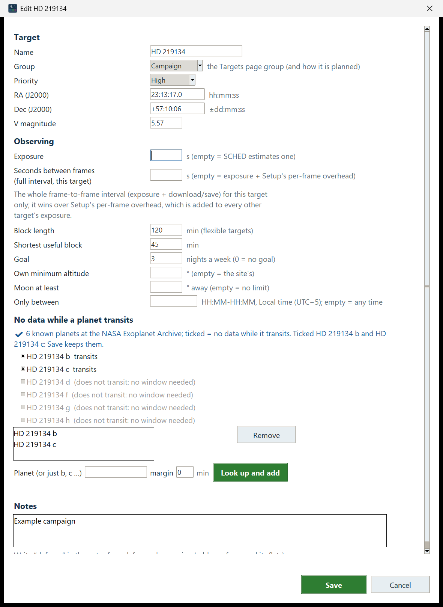
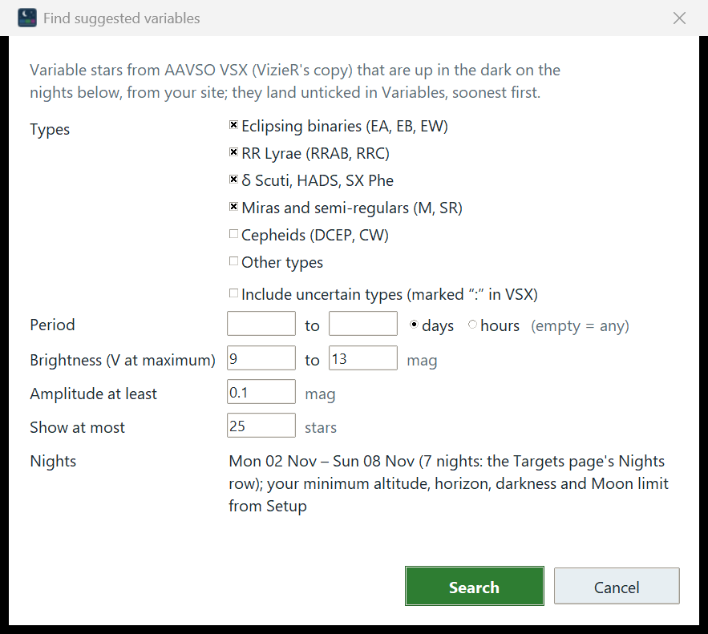

# 5. Targets

The Targets page is your list of what you want to measure. You add targets by name, tick the ones to plan, and let
SHOBS-SCHED suggest more for the coming nights.

Its subtitle reads: *What you want to measure. Tick Plan (☑) to plan a target, click its Priority to change it,
select a row for its details, and double-click it to edit. Each list shows the next event in the planned nights;
drag the bar between Transits and Variables to share the room.*

This chapter covers:

- the three boxes (Campaigns, Transits, Variables) and their columns,
- the **Nights** row,
- adding a target by name, and what happens with stars that are not a planet or a known variable,
- **Plan**, **Priority**, **Keep**, **Edit…** and **Remove**,
- the Edit dialog, including a star's known planets and no-transit windows,
- **Find suggested transits…** and **Find suggested variables…**,
- ephemeris precision, and how SHOBS-SCHED upgrades it for you.

## The three boxes

Targets sit in three boxes, by type. Each box has its own scroll bars, and the mouse wheel scrolls the box under the
pointer.

| Box | What goes in it | How it is planned |
|---|---|---|
| **Campaigns** | Stars or fields you visit on many nights: a long-running variable star program, a star field you monitor, a planet host you watch between transits. | A flexible block at the best part of the night, with an optional weekly goal and its own rules. |
| **Transits** | Transiting exoplanets with an ephemeris. | At the transit's time, with baseline before and after. |
| **Variables** | Variable stars from AAVSO VSX. | Eclipsing binaries at their timed minima; pulsators and long-period stars as flexible blocks at any time of night. |

Campaigns is a short box on top. Transits and Variables share the rest of the page; drag the bar between them to give
one more room.

Each box's title says how many targets it holds and how many are ticked to plan, and which clock the times are on,
for example **Transits (9, 2 planned) · next event in the 7 planned nights, Local time (UTC−5 → UTC−6)** (the
arrow appears when the clocks change during the planned nights). An empty box shows a
hint, such as *none yet: Add a planet, or press Find suggested transits*.

### The columns

Every box starts with **Plan** (☑ or ☐), **Name** and **V** (the star's V magnitude; for a variable, its brightest).
The others depend on the box:

| Box | Columns |
|---|---|
| **Campaigns** | **Next useful event**, **This week**, **Priority**, **RA / Dec (J2000)**, **Source** |
| **Transits** | **Period**, **Night**, **Ingress**, **Mid**, **Egress**, **Priority**, **RA / Dec (J2000)**, **Source** |
| **Variables** | **Type**, **Period**, **Night**, **Next min / max**, **Priority**, **RA / Dec (J2000)**, **Source** |

Periods under a day are shown in hours (*5.31 h*), longer ones in days (*3.52490 d*).

### The next event in the planned nights

The event columns show each target's **first useful event in the planned nights** (the **Nights** row, below), on the
site's clock. They are worked out in the background after the page opens; until then they show **…**.

- **Transits**: the night, ingress, mid-transit and egress of the first transit that happens entirely in the dark
  with the star above your limits. If only part of a transit is visible, the night says **(partial)**. If none falls
  in the planned nights: *none in the next 7 nights* (or *none tonight* for one night).
- **Variables**: the night and the time of the next timed event, for example **min 01:14** (an eclipsing binary's
  minimum) or **max 22:05**. A star with no timed event shows **any time** on the first night it is up long enough.
  A suggested star whose published elements are too old to give a good time shows **any time ⚠ time uncertain ±45
  min** (or **⚠ no usable timing**); a short pulsator suggested for a whole cycle shows **any time (a whole cycle)**.
- **Campaigns**: **every night**, or, for a campaign with a no-transit window, *every night; next blackout Thu 29 Oct
  21:43–23:22 (HD 219134 c transits)*.

The rows are sorted by these events: Transits soonest transit first; Variables night by night, with each night's
timed minima and maxima first, then its any-time stars; Campaigns by name. Rows with no event in the planned nights
come last. A row stays in its place when you tick or untick it.

### The Source column

**Source** says where the target came from: **✔ NEA** or **✔ NEA (most precise)** (the NASA Exoplanet Archive; the
second when a more precise published ephemeris than the Archive's default was chosen), **✔ VSX** or **✔ VizieR VSX**
(AAVSO VSX, directly or through VizieR's copy), **✔ SIMBAD**, or **typed**. A suggestion shows *suggested · NEA* or
*suggested · VizieR VSX*, and keeps showing it after you tick it (until you press **Keep**). A transit whose predicted mid-time is uncertain by more than 10 minutes adds a **⚠ Tc ±**
note (see "Ephemeris precision" below).

### Details of the selected target

Click a row to see its details on a line under the boxes: for a transit, its depth, duration, period, the predicted
mid-time uncertainty (*Tc ± 1.4 min*) and where the ephemeris came from; for a variable, its type and period; for a
campaign, its rules, goal and progress; and for every target, its exposure (yours, or *SCHED estimates it*), block
length and notes. A suggestion also shows its score.

## The Nights row

Under **Add a target** is the **Nights** row: **from** (tonight, or any of the next 13 nights) **for** (1 to 7
nights). These are the nights that:

- the event columns look at,
- **Find suggested transits…** and **Find suggested variables…** search,
- the Schedule page builds.

The Schedule page has the same two controls; changing them on either page changes both. The number of nights is
remembered between sessions; the first night goes back to tonight each time you start the program.

## Add a target by name

1. Type a name in **Add a target**: a planet (`WASP-12 b`, `TrES-3b`, `toi 2046 b`), a variable star (`DY Peg`,
   `V0404 Lyr`) or any star SIMBAD knows.
2. Press **Enter** or click **Add**.
3. The busy bar at the lower left says *Looking up DY Peg…*. When it is done, a result line beside **Add** says
   *✔ Added DY Peg (VSX).*

The new target is ticked to plan, selected, and its details are shown.

How the name is looked up:

1. **A planet name** (or a star the NASA Exoplanet Archive knows as a planet host) is looked up at the **NASA
   Exoplanet Archive**. You get the planet's position, V, depth, duration and the most precise published ephemeris.
   Spellings are forgiving: `wasp-12b`, `WASP 12 b` and `WASP-12 b` all work.
2. Otherwise, a **variable star** is looked up at **AAVSO VSX**, or VizieR's copy of it when VSX does not answer. You
   get its type, period, epoch and range. Eclipsing binaries are planned at their minima (each minimum covered ±60
   minutes, or more for a long eclipse when VSX gives the eclipse length); pulsating and long-period stars are planned
   at any time of night.
3. Otherwise, the name is looked up at **SIMBAD**, and a window asks what the star is for you (below).

Some results need a word from you:

- **A star with several planets.** Typing a host star (for example `HD 219134`) asks *"HD 219134 has more than one
  planet. Add one of them as a transit target, or the star itself (for example a campaign that keeps clear of the
  planets' transits)?"* Pick a planet, or **The star itself (a campaign or a variable)**. Planets that do not transit
  are left out of the choice and named in the question.
- **A star that is not a planet or a known variable.** A window asks **What kind of target?**, with the choices
  **Campaign (a star you visit on many nights)**, **Variable star** and **Star field (a campaign)**, plus **Transit
  target (type its ephemeris later)** when the star has no known planets. If the star has transiting planets, they are
  offered too, and a campaign or variable
  made from the star gets "no data while … transits" for each of them straight away.
- **A planet that does not transit** is never added as an empty transit target. SHOBS-SCHED offers its star instead.
- **A name already in the list** gives *⚠ DY Peg is already in the list.*
- **A service that does not answer.** If the name was looked up before, the saved copy is used, and the result
  line says so with a ⚠: *⚠ Added DY Peg (VSX). AAVSO VSX did not answer (timed out); using the copy from 3 days ago.*
  If not, it says so in plain words, for example *✖ The NASA Exoplanet Archive did not answer (HTTP 503) and there
  is no saved copy for WASP-12 b. Try again later.*

> **Tip:** A campaign that orbits a planet host, for example a star you monitor for flares, should have no data while
> its planets transit, or your light curve will have dips that are not the star's. SHOBS-SCHED offers these
> windows when you add the star; you can change them later in **Edit…**.

## Plan, Priority, Keep and Remove

- **Plan.** Click the ☑ / ☐ in a row's **Plan** column to tick or untick it. Only ticked targets are scheduled. The
  line under the boxes says *✔ DY Peg will be planned. Build the schedule to apply.* Unticked rows are shown in gray.
- **Priority.** Click a row's **Priority** cell and choose **High**, **Normal** or **Low**. Priority decides who
  wins when two targets want the same time: flexible targets are placed High first, then Normal, then Low; and
  between two fixed-time targets that collide, the higher priority wins.
- **Keep** (the button **Keep (a suggestion stays when you Find again)**). Ticking a suggestion does not make it your
  own: it stays a suggestion (*suggested · …* in Source). A search replaces every suggestion of its kind that is
  unticked at that moment, so a ticked suggestion survives a search, but once you untick it the next search removes
  it. Select one or more suggestions and press **Keep** to make them your own: they stay in the list, ticked or not,
  and Source shows **✔ NEA** or **✔ VizieR VSX**. (Keep on a target that is not a suggestion says *⚠ Select a
  suggested transit or variable to keep.*)
- **Remove** removes the selected targets after a question. Blocks already planned for them stay until you rebuild.
- **Edit…** (or double-click a row) opens the Edit dialog for one target.

You can select several rows in one box with **Ctrl**-click or **Shift**-click; selecting in one box clears the
others.

## The Edit dialog

**Edit…** opens a dialog titled with the target's name (**Edit HD 219134**) with its settings in parts: **Target**,
**Observing**, **Ephemeris** (transits only), **No data while a planet transits** and **Notes**. The dialog sizes
itself to its contents and scrolls if it is taller than the screen.

### Target

**Name**, **Group** (**Transit**, **Variable** or **Campaign**: which box the target sits in, and how it is planned),
**Priority**, **RA (J2000)** (`hh:mm:ss`), **Dec (J2000)** (`±dd:mm:ss`) and **V magnitude**.

Moving a target to another group: a planet moved out of Transits loses its ephemeris (the dialog warns *⚠ Saving
moves … out of Transits; its ephemeris is dropped.*) and becomes its star. A star moved into Transits needs a typed
period and Tc; if it has transiting planets, the dialog suggests adding the planet on the Targets page instead.

### Observing

| Field | What it does |
|---|---|
| **Exposure** | Your exposure in seconds. Empty: SHOBS-SCHED estimates one from V, your telescope and camera, and the seeing, so the star's peak stays under your linear limit. |
| **Seconds between frames (full interval, this target)** | The whole frame-to-frame time, exposure plus download and save, for this target only. Empty: the exposure plus Setup's per-frame overhead. Used to count frames. |
| **Block length** | Minutes you want per visit (flexible targets: campaigns and any-time variables). 120 by default. |
| **Shortest useful block** | The fewest minutes worth a visit. 45 by default. A visit shorter than this is not planned. |
| **Goal** | Nights a week (0 to 7) for a campaign; 0 = no goal. |
| **Own minimum altitude** | This target's own limit, above the site's. Empty = the site's. |
| **Moon at least** | The closest the Moon may come, in degrees. Empty = no limit. |
| **Only between** | Clock times on the site's clock, `HH:MM-HH:MM` (e.g. `21:00-02:30`). Empty = any time. |

Why an own exposure matters: the estimate is a cold start, good to within a factor of two or so. Once you know what
works for a star (from SHOBS-P's peak values, for example), type it here. The planner then predicts the peak for your
exposure and warns (*⚠ estimate: peak ~52k, near your 32k limit — check a frame*) only when it looks clearly too
long (over 1.5 × your limit).

### Ephemeris (transits)

For a transit target: **Period** (days), **Tc (T0)** (mid-transit time, BJD_TDB), **Duration** (hours), **Depth**
(%) and **Reference**. A changed ephemeris is marked as typed, and the uncertainty of a changed period or Tc is
dropped (change both, and the details line shows *Tc —* until you add the planet again by name).

### No data while a planet transits

For a star that hosts transiting planets, you may want no data while a planet transits. When the dialog opens for a
campaign or variable, SHOBS-SCHED asks the NASA Exoplanet Archive for the star's known planets (the busy bar at the
dialog's lower left says *Looking up HD 219134's planets at the NASA Exoplanet Archive…*), by name and by position.

- Each **transiting** planet gets a tick: ticked = no data while it transits. The first time a star's planets are
  offered, they are all ticked; after that, your choice is kept.
- Planets that do not transit are shown grayed, with the reason (*does not transit: no window needed*).
- The list under the ticks shows the windows the target has. Select one and press **Remove** to drop it.
- To add a planet by hand, type its name (or just its letter, **b**, **c**…) in **Planet (or just b, c …)**, an
  optional **margin** in minutes either side, and press **Look up and add**.

During a planet's transit (plus the margin), the planner never schedules this target. The block's notes say so, for
example *No HD 219134 after 04:28 (planet c transit)*.

If the Archive cannot be reached, the dialog says *✖ Couldn't reach the NASA Exoplanet Archive to list this star's
planets… Type a planet below instead.*

### Notes

Free text, shown in the block's notes on the plan. One word has a meaning of its own: write **defocus** in the notes
of a target you observe defocused. The planner then adds a refocus after its block (*Refocus after this block*),
asks for flats at the defocus position too, and allows for the wider stars in the exposure estimate (Setup's
**Defocus widens stars ×**).

Press **Save** to keep the changes (or **Enter**, except in the notes and the planet box). If a value is wrong, the
dialog says why, for example *✖ Not saved: The shortest useful block cannot be longer than the block length.*

## Find suggested transits

**Find suggested transits…** searches every known transiting planet for good transits on the planned nights, from
your site.

1. Press **Find suggested transits…** (bottom right).
2. A window shows **Show at most** (how many transits; 25 by default, remembered) and the **Nights** it will search
   (the Nights row). Its text says the planets are *filtered by Setup's Suggested-transits settings (V range, depth,
   Moon)*; in 1.1.0 the Setup page has no such fields. The filter is set in the settings file only (below).
3. Press **Search**.
4. The busy bar at the lower left counts through the planets: *Finding suggested transits… 120 of 640*. It looks at
   the Archive's list of transiting planets (refreshed weekly), then checks the best of them again with each planet's
   most precise published ephemeris.
5. The result line says, for example, *✔ 12 suggested transits found, soonest first.*

The suggestions land **unticked** in the Transits box, among your own targets. Tick one to plan it; it is still a
suggestion. Suggestions that are unticked when you search again are replaced; press **Keep** to keep one for good.

What makes a suggestion (the filter: the `suggest_…` values in the settings file, chapter 4; there is no Setup field
for them):

1. **A full transit with baseline.** The whole transit, plus 30 minutes of baseline each side, is above your
   minimum altitude, horizon and maximum airmass. The transit itself is in the planning darkness; the baselines may
   reach into nautical twilight.
2. **A star you can measure well**: V between 9 and 13.
3. **A deep enough transit**: at least 0.5 %.
4. **Not washed out by the Moon**: the Moon brightens the sky by no more than 3 magnitudes over the transit.
5. **Ranked by the signal-to-noise you can expect**: depth × √(minutes in transit) ÷ the noise for that star's
   brightness and the Moon-brightened sky. A planet whose predicted mid-time is uncertain gets a bonus, because new
   timings of it add the most to what is known.

Each planet appears once, on its best night. Planets already in your list (your own, or ticked suggestions) are not
suggested again.

> **Tip:** If SHOBS-P is installed, its *Tonight's transits* finder's V range, depth and baseline were taken as
> these starting values, once (chapter 4).

## Find suggested variables

**Find suggested variables…** searches AAVSO VSX (through VizieR) for variable stars worth a look on the planned
nights.

1. Press **Find suggested variables…**.
2. Choose the search in the window (your choices are remembered):
   - **Types**: **Eclipsing binaries (EA, EB, EW)**, **RR Lyrae (RRAB, RRC)**, **δ Scuti, HADS, SX Phe**, **Miras and
     semi-regulars (M, SR)**, **Cepheids (DCEP, CW)**, **Other types**. The first four are ticked at first. **Include
     uncertain types (marked ":" in VSX)** is off at first.
   - **Period** from … to …, in **days** or **hours** (empty = any).
   - **Brightness (V at maximum)** from … to … mag (at first, the same range as the suggested transits).
   - **Amplitude at least** (0.1 mag at first).
   - **Show at most** (25 at first).
   - The **Nights** searched. The window says your minimum altitude, horizon, darkness and Moon limit come from
     Setup; the first three do, but the Moon limit is the settings file's `suggest_moon_penalty_max` (chapter 4).
3. Press **Search**. The busy bar says *Finding suggested variables (VSX at VizieR; up to a minute or two)…* and counts
   through the candidates.
4. The result line says, for example, *✔ 14 suggested variables found, soonest first.* The line under the boxes says
   how many catalog stars matched.

A star is suggested when, on at least one of the nights, it offers something you can catch:

| Kind | What must fit | Why |
|---|---|---|
| **Timed events**: eclipsing minima, RR Lyrae maxima | The event, ± its half-width, in the dark and above your limits. | A minimum timing gives an O − C point; you need the whole minimum. |
| **A whole cycle**: δ Scuti, HADS, SX Phe, short Cepheids, RR Lyrae without a usable epoch | One full cycle plus 30 minutes in one dark stretch above your limits. | A whole cycle in one night shows the full light curve. |
| **Any time**: Miras, semi-regulars and other long-period stars | At least an hour above your limits in the dark. | One good point a night is what these stars need. |

In every case the Moon must not brighten the sky by more than the suggested-transit limit (`suggest_moon_penalty_max`). A star whose VSX elements
are too old to predict its event to within 30 minutes is not promised at a time: it is offered as a whole-cycle or
any-time target instead, with **⚠ time uncertain** in its event column.

Suggestions are ranked by amplitude, by brightness within your V range, and by having a timed event soon, with a
small bonus for being good on many of the nights. They land unticked in the Variables box; tick, **Keep** or ignore
them as with transits.

If VizieR's row limit was reached, the line under the boxes says so: narrow the V range, the period range or the types
to reach the rest.

## Ephemeris precision

A transit's predicted mid-time is only as good as its ephemeris. An ephemeris published years ago, with a small error
in the period, can be off by an hour today. That is why SHOBS-SCHED cares where each ephemeris came from:

- **Adding a planet** looks at every published ephemeris for it at the Archive and keeps the one with the smallest
  predicted uncertainty for the coming weeks (it keeps the Archive's default set unless another beats it by more than
  5 %).
- **Suggestions** first come from the Archive's planet list, then the shortlist is checked again with each planet's
  most precise ephemeris, so a stale one neither offers a transit that is not there nor hides one that is.
- **Upgrading.** A transit still carrying the planet list's ephemeris (for example a suggestion you ticked or kept)
  is upgraded in the background to the most precise one: when you tick it, when you keep it, and each time
  SHOBS-SCHED starts. The busy bar says *Checking transit ephemerides at the NASA Exoplanet Archive…*, and when one changes the line under the
  boxes says *✔ Most precise ephemeris now used for TOI-1234 b (was the Archive's planet-list value). Build the
  schedule to apply.*

The predicted mid-time uncertainty (*Tc ± 1.4 min*) is shown in the target's details. Above 10 minutes it gets a
**⚠** in the Source column and in the plan's notes (*⚠ Ephemeris uncertain: mid-time ± 25 min*). Such a transit is
still worth observing (a new timing is valuable), but plan extra baseline: the transit may come early or late.

---

Previous: [4. Setup](04-setup.md) · Next: [6. Schedule](06-schedule.md)
