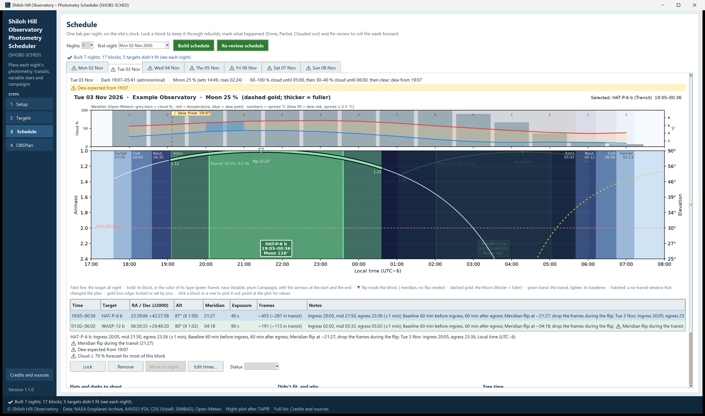

# 6. Schedule

The Schedule page turns your ticked targets into a plan for each night. It also keeps the record of what happened:
after each night you mark each block, and SHOBS-SCHED rolls the week forward around it.

Its subtitle reads: *One tab per night, on the site's clock. Lock a block to keep it through rebuilds; mark what
happened (Done, Partial, Clouded out) and Re-review to roll the week forward.*

This chapter covers:

- building a schedule, and how the planner fills a night,
- the night tabs and the night plot,
- the nightly table and its notes,
- locking, removing, moving and re-timing blocks,
- flats and darks, what didn't fit (and **Plan this instead**), free time,
- the weather and dew,
- marking **Done**, **Partial** and **Clouded out**, and **Re-review schedule**,
- weekly goals for campaigns,
- the out-of-date and past-night warnings.

## Build a schedule

1. At the top of the page, choose **Nights** (1 to 7) and the **first night**. The first night is tonight by
   default; pick one of the next 14 nights from the list, or type any date (`2026-11-03`, `3 Nov`). These are the
   same nights as the Targets page's **Nights** row.
2. Press **Build schedule**.
3. The busy bar at the lower left of the window shows each step: *Getting the forecast from Open-Meteo…*, then
   *Building 7 nights…*. **Build schedule** and **Re-review schedule** are grayed out until it finishes.
4. When it is done, **✔ Done** appears beside the button, and the line under the controls says what was built, for
   example *✔ Built 7 nights: 11 blocks; 2 targets didn't fit (see each night).*

If the forecast could not be fetched, the plan is still built, and the line says so with a ⚠: *⚠ Built 7 nights: 11
blocks. No forecast (Open-Meteo did not answer (timed out)), so it was built without weather.* When an older saved
forecast was used instead, the line says how old it is.

The schedule is saved after every change, so it is there the next time you start SHOBS-SCHED.

Building again keeps your work: every block you **locked**, set the times of, or **marked** (Done, Partial, Clouded
out) stays on its night with its times and its mark, and the rest of the night is rebuilt around it. A build that
starts later than the saved schedule moves the nights before it into the history, marks included.

> **Tip:** Building needs your site (latitude, longitude, time zone) and at least one ticked target. Without a site
> the page says *✖ Enter your site on the Setup page first (latitude, longitude, time zone); then build.* Without a
> ticked target it says *⚠ No targets are ticked to plan (☑ on the Targets page).*

### How a night is filled

The planner fills each night in a fixed order. Knowing it helps you read the plan:

1. **Your blocks first.** Locked blocks, blocks whose times you set, and blocks already marked stay exactly as they
   are. If one is no longer possible (the target is below your limits, outside the darkness, inside a no-transit
   window, or overlapping another of your blocks), it stays and gets a ⚠.
2. **Fixed-time targets next.** Transits (from the baseline before ingress to the baseline after egress) and timed
   variable events (a minimum or maximum ± its half-width). The transit itself must be in the planning darkness and
   above your limits; the baselines may run into nautical twilight, and may be shortened to fit the night. When two
   fixed-time targets collide, their baselines are trimmed first, down to 20 minutes a side (*⚠ Baseline trimmed*).
   If they still collide, one wins: higher priority first, then the rarer chance (a transit not seen again for a
   month beats one that comes back in three nights), then the better signal-to-noise.
3. **Flexible targets last.** Campaigns and any-time variables, High priority first, then Normal, then Low. A
   campaign behind its weekly goal moves up one level. Each gets at most one block a night, of its **Block length**
   (or less when there is less room, but never under its **Shortest useful block**), placed at the best part of the
   night for it: on an equatorial mount starting about 12 minutes before its meridian (so the mount flips at the start
   and the whole run is on one side of the pier), on an alt-az mount centred on the meridian. Its own rules apply:
   **Own minimum altitude**, **Moon at least**, **Only between**, and its no-transit windows.
4. **Overheads.** A few minutes between blocks for slewing and plate solving, autofocus at the start of the night,
   and a refocus after a defocused target.
5. **Weather.** With the dew setting on, flexible blocks end when dew is expected (Setup, chapter 4).

## The night tabs

Each night has a tab named by its date, for example **Tue 20 Oct**. A **⚠** in front of the name means the night has
a caution, a target that didn't fit, or a night-wide warning. A night that has passed says **(past)**.

A tab is built the first time you open it. At the top is the night's line: the date, the dark hours and which darkness
(*Dark 19:42–05:58 (astronomical)*), the Moon (*Moon 62 % (rises 23:10)*) and the weather summary (*Clear until
02:00, then 60–80 % cloud; dew from 04:05*). Under it come any night-wide warnings, such as *⚠ Dew expected from
04:05*, or *✖ No dark time tonight: the Sun gets no lower than −15.2° (planning darkness −18.0°); nautical darkness
(Sun below −12°) is possible if you allow it in Setup.*

## The night plot

The night plot shows the whole night at a glance. Its design follows the airmass plot of TAPIR by Eric Jensen
(chapter 9).

- **Across:** the time on the site's clock, from 1.5 hours before nautical dusk to 1.5 hours after nautical dawn,
  with the sunset, twilight and sunrise times along the top. The sky is shaded by twilight: lighter at dusk and
  dawn, darkest in astronomical night.
- **Down:** airmass on the left (1.0 at the top), altitude on the right. The dashed line is your maximum airmass.
- **Each planned target:** its path through the whole night is drawn faint; its block is drawn bold in its type's
  color (green Transit, navy Variable, plum Campaign), with the airmass at the block's start and end. A label box
  gives its name, start and end, and its distance from the Moon.
- **Transits:** the transit itself (ingress to egress) is a green band, its baselines a lighter band.
- **Meridian:** a **▼** marks a meridian flip inside a block; a **|** marks a meridian crossing that needs no flip.
- **The Moon:** a dashed gold line, thicker when fuller.
- **No-transit windows:** hatched, but only where one changed the plan.
- **Locked blocks** and blocks you set the times of have a gold box edge.
- **Weather strip** (above the plot, on the same time axis): gray bars for cloud %, a red line for temperature and a
  blue line for the dew point, the spread (temperature minus dew point) as numbers along the top, a blue fill where
  dew is likely (spread under your Setup threshold), and a dashed line with *⚠ dew from 04:05* at the dew onset. With
  no forecast, the strip says *No forecast for this night*.

Point at the plot to read the values under the pointer on the line under it: the time, the target or Moon line
nearest the pointer (airmass and altitude), the block at that time, and that hour's weather. **Click a block** to
select its row in the table; the selected target is drawn bright and thick and every other one fades. Click beside
the blocks to clear it. A legend under the plot repeats these meanings.

The plot grows with the window: a taller window gives a taller plot.

> **Note:** If Matplotlib is missing, the plot's place shows *⚠ Night plot needs matplotlib — run Create
> shortcuts.bat again*. Everything else on the page works. See chapter 10.

## The nightly table

One row per block, in time order, tinted by the target's type:

| Column | What it shows |
|---|---|
| **Time** | Start–end on the site's clock. |
| **Target** | The name, with *· locked*, *· set by you*, or the mark (*· Done*, *· Partial*, *· Clouded out*). |
| **RA / Dec (J2000)** | The target's position. |
| **Alt** | The highest altitude in the block and its airmass, e.g. *62° (X 1.13)*. |
| **Meridian** | When the target crosses the meridian, with *(flip)* when the mount flips during the block. |
| **Exposure** | The exposure, with *(est.)* when SHOBS-SCHED estimated it. |
| **Frames** | About how many frames fit (*~240*); for a transit also how many fall in the transit (*~240 (~135 in transit)*). |
| **Notes** | What to know about this block (below), cautions first. |

Click a row to select it (and pick it out on the plot). The line under the table shows its notes and cautions in
full.

### Notes you will see

- **Transits**: *Ingress 21:32, mid 22:44, egress 23:56 (±1 min)* and *Baseline 60 min before ingress, 60 min after
  egress*.
- **Timed variables**: *Minimum at 01:14* or *Maximum at 22:05*.
- **Any-time variables**: *About 1.3 cycles (P ≈ 1.75 h)*, how much of the light curve you will cover.
- **Campaigns with a goal**: *Goal: 3 nights a week*.
- **No-transit windows**: *No HD 219134 after 04:28 (planet c transit)*.
- **Flips**: *Start before the meridian and let it flip (~22:40); drop the pre-flip frames*, *Meridian flip at
  ~01:10; drop the frames during the flip*, or *Ends 3 min past its meridian, inside your tracking margin; stop by
  03:38 at the latest*.
- **Your own frame interval**: *Frames every 45 s (your seconds between frames)*.
- **Defocused targets**: *Refocus after this block*.
- Your own notes from the target's Edit dialog.

### Cautions (⚠)

| Caution | What it means |
|---|---|
| *⚠ Ephemeris uncertain: mid-time ± 25 min* | The transit may come early or late. Worth observing; consider extra baseline. |
| *⚠ Baseline trimmed (next to WASP-12 b)* | It shares the night with another fixed-time target; its baseline is shorter. |
| *⚠ Meridian flip during the transit (23:05)* | The flip falls between ingress and egress. Expect a gap and a step in the light curve. |
| *⚠ Starts 20 min after its meridian: the mount may flip at once* | Start before the meridian time if you can. |
| *⚠ Counterweight up beyond HA ±6 h (04:10)* | Equatorial mount: the target is more than 6 hours from the meridian during the block, so the mount runs counterweight-up. Check your mount allows it. |
| *⚠ Zenith keyhole: 87° at 23:40* | Alt-az mount: the target passes too near the zenith to track smoothly. |
| *⚠ estimate: peak ~45k, near your 32k limit — check a frame* | Your exposure may go past the linear limit. Take a test frame. |
| *⚠ estimate: even 0.75 s may saturate…; defocus* | A star too bright for the shortest standard exposure. Defocus, and write "defocus" in its notes. |
| *⚠ Dew expected from 04:05* | Dew is forecast during the block. |
| *⚠ Cloud ≥ 70 % forecast for most of this block* | The forecast is poor; the block stays (you decide). |
| *⚠ Below your limits 03:10–03:40* | One of your own (locked) blocks now runs below your limits. |
| *⚠ Overlaps your block …* / *⚠ Inside a blackout: …* | One of your own blocks clashes with another or with a no-transit window. |

## Change a block

Select a row, then use the buttons under the table. A result line under the buttons says what happened.

- **Lock** keeps the block's times through every rebuild (*✔ HAT-P-23 b locked: it keeps its times when you
  rebuild.*). The button reads **Unlock** for a locked block.
- **Remove** takes the block off this night (*it comes back when you rebuild unless you untick it*).
- **Move to night…** moves a flexible block to another night of the schedule, at the same place in the sky (about 4
  minutes earlier on the clock each night later). The block is locked there, and that night is rebuilt around it. A
  transit or a timed event cannot move: its time is set by the sky, so the button is grayed for those.
- **Edit times…** asks for a new start and end (`HH:MM` on the site's clock). The block is marked *set by you*, keeps
  those times through rebuilds, and the night is rebuilt around it. The times must be between sunset and sunrise, and
  must not overlap a block that stays put (fixed, locked, set by you, or marked).

When the change leaves a problem, the result line says so with a ⚠, for example *⚠ BL Cam set by you: 23:10–01:00.
Below your limits 00:40–01:00*.

While a build or rebuild runs, these buttons wait: *⚠ Wait for the build to finish.*

## Flats and darks, didn't fit, free time

Under the table are three boxes.

**Flats and darks to shoot.** For example *Flats: one set at the night's camera angle; a meridian flip's 180° turn
needs no new flats*, and *Darks to shoot: 0.75 s, 45 s, 60 s*. A defocused target adds *flats at the defocus position
too*. Darks you already have can be listed in the settings file (`darks_on_hand`, chapter 4); then the line says
*Darks: all on hand (…)*.

Why one set of flats is enough after a flip: a flip turns the camera 180° with the telescope, so the dust and
vignetting stay where they were relative to the sensor. A rotator angle change is different, which is why the plan
keeps the camera angle fixed.

**Didn't fit, and why.** Every ticked target that got no block, with the reason and its next chance, for example:

- *WASP-12 b: collides with HAT-P-23 b; next chance Fri 23 Oct*
- *BL Cam: below your limits all night (highest 24°; limit 30° there); next chance Mon 26 Oct*
- *DY Peg: no free stretch of 45 min left tonight (longest 30 min)*
- *KELT-1 b: no transit tonight*

When another block took the room (a collision, or no free stretch left), a green **Plan this instead** button appears
under the line. It rebuilds the night with that target first; the one that gave way then appears here instead. The
result line says *✔ Rebuilt with WASP-12 b first.*, or *✖ Still didn't fit: …* when it cannot be done.

**Free time.** Gaps of 15 minutes or more with nothing planned, for example *Free 02:10–03:00 (50 min)*. A good place
for an extra any-time variable, or for flats and darks.

## Weather and dew

The forecast comes from Open-Meteo for your site each time you build or re-review. It is shown:

- in the night's line (the summary),
- in the weather strip over the night plot,
- in the blocks' cautions (dew, cloud),
- on the plan card.

Why dew matters for photometry: a dewing corrector or mirror dims the stars gradually, which looks like a slow
trend in your light curve, or ruins a transit's egress. With **End dew-sensitive runs at the predicted dew onset**
ticked in Setup, flexible blocks end at the dew onset (*⚠ Dew expected from 04:05: the block ends there*). Fixed-time
blocks are not cut: a transit happens when it happens, so it gets a ⚠ instead, and you decide.

Cloudy hours are not removed from the plan. A block that is mostly under 70 % cloud or more gets a ⚠; the plan
stays, because forecasts change.

## After the night: mark what happened

1. Open the night's tab.
2. Select a block.
3. Choose its **Status**: **Done**, **Partial** or **Clouded out**. The empty entry at the top of the list clears a
   mark (*✔ BL Cam: mark cleared (planned, not marked).*).

Marked blocks stay where they are on rebuilds, and the table shows the mark. Done and Clouded out rows are grayed.

What each mark means for the planner:

| Mark | Counts toward a campaign's weekly goal? | Target back in the pool for later nights? |
|---|---|---|
| **Done** | Yes | No need |
| **Partial** | No (counts as missed) | Yes |
| **Clouded out** | No (counts as missed) | Yes |

## Re-review: roll the week forward

**Re-review schedule** moves the schedule on to tonight:

1. Nights before tonight go into the history, with their marks.
2. The schedule keeps its length (seven nights stays seven nights), so new nights are added at the end.
3. Everything that is not locked, set by you or marked is rebuilt, with a new forecast. Targets clouded out or only
   partly observed are back in the pool and get planned again where they fit.

If locked blocks on past nights were never marked, SHOBS-SCHED asks first: they would go to the history as Planned,
not Done. Mark them first if you observed them.

The busy bar says *Re-reviewing…* while it works, and the line under the controls reports the result as for a build.

## Weekly goals for campaigns

A campaign with a **Goal** (nights a week, in its Edit dialog) is paced through the week, Monday to Sunday:

- Only **Done** nights count.
- A campaign is **behind** when it cannot reach its goal without tonight, or is behind an even pace through the week.
  A goal of 1 is behind from Monday until it has a night; a goal of 2 is behind from Monday until it has one night,
  and from Thursday until it has two.
- A campaign that is behind is placed one priority level higher. If there is no room at all, it may shorten other
  flexible blocks (toward their shortest useful length) to get its night.

The Targets page's **This week** column shows the progress, for example *2 of 3 this week*.

## Warnings about the schedule itself

- **Setup or targets changed.** After you save a change in Setup, or change a ticked target (tick, untick, edit,
  priority), the schedule was built from the old values. The page says *⚠ Setup or targets changed since this
  schedule was built: press Build schedule (or Re-review) to rebuild it with the changes.* The OBSPlan page shows a
  similar warning, and still lets you print and export. Unticked suggestions coming and going do not count.
- **The schedule starts before tonight.** *⚠ The schedule starts on Mon 19 Oct, before tonight. Mark what happened
  and press Re-review schedule to roll it forward.* Past nights stay visible as a record, with a ⚠ line above the plot.
- **Every night has passed.** *⚠ Last built for Thu 22 Oct (past): press Build schedule.*

---

Previous: [5. Targets](05-targets.md) · Next: [7. OBSPlan](07-obsplan.md)
