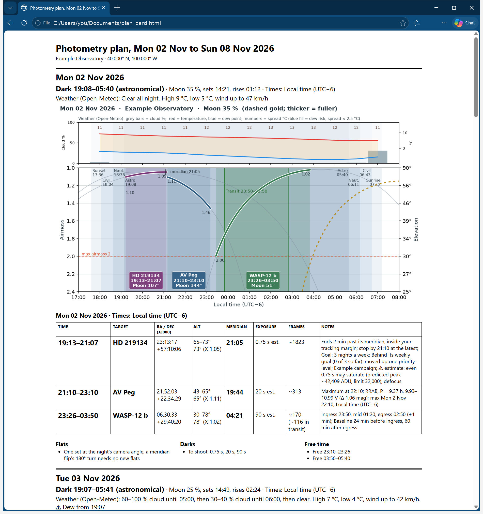

# 7. OBSPlan: the plan card, ASIAIR and NINA

The OBSPlan page is the plan card itself, on screen: the nights you tick, laid out the way they print. From here you
print the card, and send one night at a time to ASIAIR or NINA.

Its subtitle reads: *The plan card for the ticked nights. Print it, or send one night at a time to ASIAIR or NINA:
their imports take the targets' positions only; times, exposures and notes stay on the card.*

This chapter covers:

- choosing the nights,
- what is on the card,
- printing, with or without the night plots,
- **Export to ASIAIR**, **Copy ASIAIR list** and the ASIAIR export folder,
- **Export to NINA**,
- the camera angle in both lists.

## Choose the nights

Under **Nights** is one tick per night of the schedule, with its number of blocks, for example **Tue 20 Oct (3
blocks)**. Tonight and the nights after it are ticked at first; past nights are not. The card below shows the ticked
nights; **Print plan card** prints them.

With no schedule yet, the page says *No schedule yet: build one on the Schedule page.*

## What is on the card

The printed card's title is **Photometry plan, Tue 20 Oct 2026** for one night, or **Photometry plan, Tue 20 Oct
to Mon 26 Oct 2026** for several. Under it is your site line: the site's name, its latitude and longitude, and your
observer code if SHOBS-P gave one (*Example Observatory · 40.000° N, 100.000° W*).

For each night:

- **The date**, with the dark hours and which darkness (*Dark 19:42–05:58 (astronomical)*), the Moon (*Moon 62 %,
  rises 23:10*), and which clock the times are on (*Times: Local time (UTC−5)*).
- **The weather**: *Weather (Open-Meteo): Clear until 02:00, then 60–80 % cloud. High 12 °C, low 4 °C, wind up
  to 15 km/h. ⚠ Dew from 04:05*.
- **The night plot** (when **Include night plots** is ticked; printed card only).
- **The nightly table**: **Time**, **Target**, **RA / Dec (J2000)**, **Alt**, **Meridian**, **Exposure**, **Frames**
  and **Notes**. The times are big and bold, so you can read them at the telescope. On screen each target's name sits on
  its type's color (the printed card is plain black on white). Locked blocks say *(locked)*, blocks you timed say *(set by you)*, and marked blocks show their mark
  in brackets (*[Done]*). Estimated exposures say *est.*
- **Flats**, **Darks** and **Free time**, as lists under the table.

The footer gives the clock once more, with the time zone's name: *SHOBS-SCHED · all times Local time (UTC−5)
(America/Chicago)* on the printed card, *All times Local time (UTC−5) (America/Chicago)* on screen.

"Didn't fit, and why" is not on the card. That is a planning decision you make on the Schedule page; the card is what
you will actually do.

## Print the plan card

1. Tick the nights you want.
2. Leave **Include night plots** ticked to print each night's plot, or untick it for a shorter card. The choice is
   remembered.
3. Press **Print plan card**.
4. While the plots are drawn, the busy bar at the lower left says *Drawing the night plots for the plan card…*
   (with a count, *2 of 7*, for several nights). **Print plan card** is grayed until it is done.
5. The card opens in your web browser, and the result line says *✔ The plan card is open in your browser; print it
   from there.* Print it from the browser (in most browsers, **Ctrl+P**).

The card is black on white with no colors you need, so it prints well on any printer. It is set up to print in
landscape. With plots, each night takes
two pages: the date, facts and plot on the first, the table and lists on the second. A table never splits across
pages if it fits on one.

The card is saved as `plan_card.html` in SHOBS-SCHED's cache folder (chapter 2), replaced each time you print. If the
browser does not open, the result line gives the file's full path so you can open it yourself.

> **Tip:** Untick past nights before printing: the card is easier to use at the telescope with only the nights to
> come.

## Export to ASIAIR

ASIAIR's **Plan** can import a list of targets. SHOBS-SCHED writes that list for one night at a time, in the order the
blocks start, each target once. It carries the targets' positions (RA and Dec, J2000) and the camera angle. ASIAIR does
not import times or exposures; those are on your plan card.

1. Find the night on the card. Beside its date are **Export to ASIAIR**, **Export to NINA** and **Copy ASIAIR list**.
2. Press **Export to ASIAIR**.
3. A result line under the night's heading says where the file went: *✔ ASIAIR: saved 3 targets for Tue 20 Oct to
   C:\Users\you\Downloads\SHOBS-SCHED_ASIAIR_2026-10-20.csv. In ASIAIR's Plan: Add → Import, and paste the file's
   text. Position angle 0.00° (set your usual camera angle in Setup).*
4. Under the line are **Open folder**, **Open in Notepad** and **Show file contents ▸** (which shows the file's text
   right there).
5. In ASIAIR, open **Plan**, choose **Add → Import**, and paste the file's text.

The file is named `SHOBS-SCHED_ASIAIR_<date>.csv`. Its format is the one Telescopius gives ASIAIR (*Pane, RA, DEC,
Position Angle (East), Pane width (arcmins), Pane height (arcmins), Overlap, Row, Column*), with each target's name in
the first column, in plain letters.

### The ASIAIR export folder

By default the files go to your Downloads folder. To have them land on the phone or tablet that runs ASIAIR:

1. Under **ASIAIR export folder:**, press **Choose folder…**.
2. Pick a folder that syncs to that device, for example an iCloud Drive or OneDrive folder.
3. The line says *✔ Export to ASIAIR now writes to …*. Each night's file is then waiting on the device.

**Use Downloads** (shown once you have chosen a folder) goes back to the Downloads folder. If the chosen folder goes missing (a drive not connected), the
folder line shows *⚠ not found: files go to Downloads*, and the export says where the file went instead.

### Copy ASIAIR list

**Copy ASIAIR list** puts the same list on the clipboard instead of in a file: *✔ Copied 3 targets for Tue 20 Oct.
In ASIAIR's Plan: Add → Import, and paste. Position angle 0.00° (set your usual camera angle in Setup).* Use it when ASIAIR runs on the same computer, or you paste through a
remote-desktop app.

## Export to NINA

**Export to NINA** writes the night's targets for N.I.N.A.'s Sequencer, in the same Telescopius layout (proper CSV,
with each target's real name). The file goes to your Downloads folder as `SHOBS-SCHED_NINA_<date>.csv`.

In NINA: **Sequencer → Import targets**, and pick the file. The result line warns you, as NINA's import does: *It
REPLACES the targets now in the sequence; each target gets your default sequence template.* So set up your default
template for photometry (exposure, filter, and so on) first, or adjust each target after the import.

As with ASIAIR, the file carries positions and the camera angle only.

## The camera angle

Both lists give each target a **position angle**: Setup's **Usual camera angle (rotator)** (chapter 4), the same
for every target. The line under **Print plan card** says what it is, for example *ASIAIR and NINA lists: position
angle 210.00° (Setup's usual camera angle)*.

Why it matters: ASIAIR reads the angle as "turn the camera to this angle". If it were left at 0° while your flats
were taken at another angle, the plan would turn the camera and your flats would no longer match the frames. Set your
usual angle in Setup (or read it from a FITS frame) so the plan keeps the camera where your flats were taken. When no
angle is set, 0° is written and the line says *set your usual camera angle in Setup*.

## When the plan is out of date

If Setup or your targets changed since the schedule was built, a ⚠ bar at the top of the page says *⚠ Plan out of
date: Setup or targets changed since it was built. Press Build schedule on the Schedule page before printing or
exporting.* Printing and exports still work, but each result line starts with *⚠ Plan out of date (Setup or targets
changed since the build).* A result for a night disappears when that night is rebuilt, since the file no longer
matches it.

---

Previous: [6. Schedule](06-schedule.md) · Next: [8. The busy bar and messages](08-busy-bar-and-messages.md)
