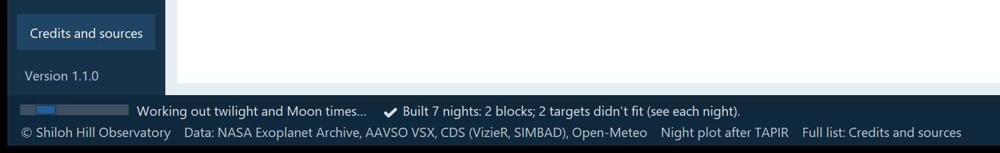
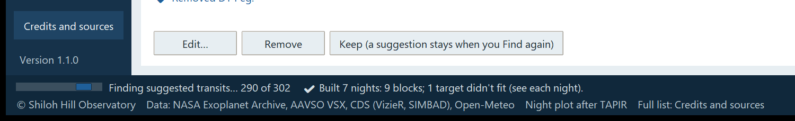

# 8. The busy bar and messages

SHOBS-SCHED tells you what it is doing in three ways: a **busy bar** while it works, a **result line** when it has
finished, and the **status strip** along the bottom of the window for the latest news. This chapter explains each,
and lists the messages you will meet most often.

## The busy bar

Whenever SHOBS-SCHED is working on something that takes more than a moment, a busy bar appears at the **lower left of
the window**, in the status strip. A small bar moves back and forth, and the words beside it say what the program is
doing. This is the same in every SHOBS program.

You see it while SHOBS-SCHED is:

| Job | The words say, for example |
|---|---|
| Looking a target up (Targets page, **Add**) | *Looking up WASP-12 b…* |
| Filling in the Targets lists' next events | *Working out each target's next event…* |
| Looking up a star's planets for a new campaign | *Looking up the star HD 219134…* |
| Finding suggestions | *Finding suggested transits… 120 of 640*, *Finding suggested variables (VSX at VizieR; up to a minute or two)…* |
| Getting the weather (Build, Re-review) | *Getting the forecast from Open-Meteo…* |
| Building the schedule | *Building 7 nights…*, *Re-reviewing 7 nights…*, *Working out twilight and Moon times…*, *Rebuilding Mon 02 Nov…* |
| Checking transit ephemerides (at startup, and when you tick or keep a transit) | *Checking transit ephemerides at the NASA Exoplanet Archive…* |
| Drawing the night plots for the printed card | *Drawing the night plots for the plan card… 3 of 7* |

Some things to know:

- **A multi-step job changes its words step by step.** **Build schedule**, for example, first says *Getting the
  forecast from Open-Meteo…*, then *Building 7 nights…*, then *Working out twilight and Moon times…*.
- **When the count is known, the words carry it.** A suggestion search says how far it has got, *… 12 of 40*. The
  bar itself still moves back and forth; it never fills up.

- **Dialogs have their own busy bar.** The Edit dialog's planet lookup, for example, shows its busy bar at the
  **dialog's** lower left (*Looking up HD 219134's planets at the NASA Exoplanet Archive…*), so the main window stays
  free.
- **You can keep working.** Lookups, searches and builds run in the background; the window stays responsive. The only
  thing that waits is the schedule itself: while a build runs, **Build schedule** and **Re-review schedule** are grayed
  out, and changes to a night's blocks say *⚠ Wait for the build to finish.*

When the job is done, the busy bar disappears.

## Result lines: ✔, ⚠ and ✖

When a job finishes, a short **result line** appears next to the button you pressed: beside **Add** on the Targets
page, beside **Build schedule** on the Schedule page, under the night's heading on the OBSPlan page, and so on. It
starts with an icon and is colored to match:

| Icon | Color | Meaning | Example |
|---|---|---|---|
| **✔** | blue on white | Done, as asked. | *✔ Added DY Peg (VSX).* |
| **⚠** | dark amber on pale yellow | Done, but read this: a caution, a saved copy used, something left out. | *⚠ Added BL Cam (VSX). AAVSO VSX did not answer (no answer within 30 s); using the copy from 3 days ago.* |
| **✖** | red | Not done, and why. | *✖ The NASA Exoplanet Archive did not answer (service unavailable, HTTP 503) and there is no saved copy for WASP-12 b. Try again later.* |

A short **✔** line beside a button, such as **✔ Done** or *✔ Added DY Peg (VSX).*, fades after a few seconds. A **⚠**
or **✖** line, and any ✔ line that carries extra information, stays until the next action, so you have time to read
it.

The same icons and colors are used everywhere: in the night's warnings, in the table's notes, on the Setup page, in
the plan card. You never need color alone to tell them apart.

## The status strip

The status strip runs along the bottom of the window:

1. **Its first line** holds the latest news from anywhere in the program, colored like a result line, for example
   *✔ Setup saved.* or *✔ Built 7 nights: 11 blocks.*
2. **Its second line** is a short credits line: *© Shiloh Hill Observatory*, *Data: NASA Exoplanet Archive, AAVSO
   VSX, CDS (VizieR, SIMBAD), Open-Meteo*, *Night plot after TAPIR* and *Full list: Credits and sources*.
3. **The busy bar** appears at the left end of the first line, before the news, while the program works.

If something unexpected goes wrong inside the window, the status strip says *✖ Something went wrong: … Details are in
…\sched.log.* See chapter 10.

## Common messages

"…" stands for the names and numbers filled in.

### Anywhere

| Message | What it means | What to do |
|---|---|---|
| *✖ Enter your site on the Setup page first (latitude, longitude, time zone).* | The site is incomplete. | Fill in Setup and **Save**. |
| *✖ This copy of SHOBS-SCHED is missing ….py (or it did not load), so this part cannot run.* | A program file is missing or damaged. | Unzip SHOBS-SCHED again. |
| *✖ Something went wrong: … Details are in ….* | An unexpected error. | Note what you were doing; see chapter 10. |
| *✖ The target list could not be saved (the file is not writable).* | Your user folder could not be written. | Check the disk and its permissions. |

### Setup

| Message | What it means | What to do |
|---|---|---|
| *✖ Not saved: Latitude is empty: (degrees, north positive).* | A required value is missing. | Type it. |
| *✖ Not saved: … must be between … and ….* | A value is out of range. | Check its units and sign (west longitudes are negative). |
| *✖ Not saved: Time zone "…" is not a zone name SHOBS-SCHED knows…* | A typed zone name is wrong. | Pick one from the list. |
| *✖ Not saved: Horizon line 3 ("…") is not two numbers: azimuth and altitude.* | A horizon line cannot be read. | Fix or delete that line. |
| *⚠ Site name cleared: it was SHOBS-P's telescope name (…)* | An older SHOBS-SCHED copied SHOBS-P's telescope name into the site name. | Type your observatory's name and **Save**. |
| *✖ … could not be read: it does not start like a FITS file (no SIMPLE card). Nothing changed.* | The file chosen for **Read from a FITS frame…** is not FITS. | Choose a `.fits` frame from your camera. |

### Targets

| Message | What it means | What to do |
|---|---|---|
| *✖ No planet, variable star or SIMBAD object is called …. Check the spelling.* | Nothing knows the name. | Check the spelling; try another catalog name. |
| *✖ … did not answer (…) and there is no saved copy for …. Try again later.* | A service is down, or you are offline, and the name was never looked up before. | Try again later. |
| *⚠ Added … (…). … did not answer (…); using the copy from … ago.* | A saved answer was used. | Fine for planning; it refreshes when the service answers. |
| *⚠ … is already in the list.* | You added a target twice. | Nothing to do. |
| *✖ SIMBAD lists … as a planet, but the NASA Exoplanet Archive has no transit ephemeris under that name. Try its Archive name (for example WASP-12 b), or type the planet's values by hand.* | A planet SIMBAD knows but the Archive does not (under that name). | Try its Archive name, or add the star and type the ephemeris. |
| *⚠ … Planet list: …* after **Find suggested transits…** | The Archive's planet list could not be refreshed. | The saved list was used; suggestions may miss the newest planets. |

### Schedule

| Message | What it means | What to do |
|---|---|---|
| *⚠ No targets are ticked to plan (☑ on the Targets page).* | Nothing to build. | Tick targets on the Targets page. |
| *⚠ Built …. No forecast (…), so it was built without weather.* | The forecast could not be fetched. | Fine; build again later for the weather. |
| *⚠ Setup or targets changed since this schedule was built…* | The plan is out of date. | **Build schedule** or **Re-review schedule**. |
| *⚠ Wait for the build to finish.* | A build is running. | Wait for the busy bar to go. |
| *✖ … happens at a time set by the sky (a transit or a timed event); it cannot move to another night.* | **Move to night…** on a fixed-time block. | Plan it on its own night instead. |
| *✖ … overlaps … Unlock, remove or move that block first, or pick other times.* | **Edit times…** clashes with a block that stays put. | Choose other times, or free the other block. |
| *✖ … is outside the night (sunset … to sunrise …).* | **Edit times…** outside the night. | Choose times between sunset and sunrise. |
| *✖ Still didn't fit: ….* | **Plan this instead** could not make room. | Read the reason; try another night. |

### OBSPlan

| Message | What it means | What to do |
|---|---|---|
| *⚠ …: nothing to export for …: no target that night has coordinates.* | The night's targets have no RA/Dec. | Add positions in the targets' Edit dialogs. |
| *⚠ … Left out (no coordinates): ….* | Some targets had no position. | As above. |
| *⚠ The chosen folder … is missing, so the file went to … instead.* | The ASIAIR export folder is not there. | Reconnect it, or choose another. |
| *✖ The browser did not open (…). The plan card is saved at …* | No browser answered. | Open the file yourself and print it. |
| *⚠ Plan out of date (Setup or targets changed since the build). …* | The file was made from an old plan. | Build again, then export again. |

---

Previous: [7. OBSPlan](07-obsplan.md) · Next: [9. Credits and citing](09-credits-and-citing.md)
