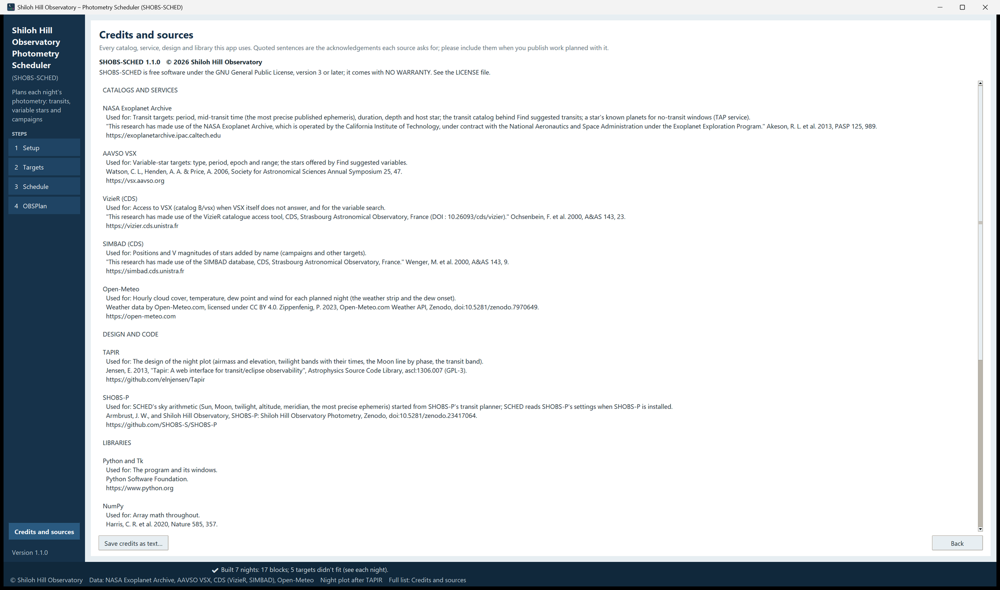

# 9. Credits and citing

SHOBS-SCHED stands on other people's work: catalogs and online services, a published plot design, Python libraries
and published methods. When you publish results from nights planned with it, please credit the sources your work
used.

## The Credits and sources page

1. Click **Credits and sources** near the bottom of the sidebar. It is not a step: **Back** returns you to the page
   you came from.
2. At the top: **SHOBS-SCHED 1.1.0 © 2026 Shiloh Hill Observatory**, and the license line.
3. Below that, the full list, in four parts:
   - **CATALOGS AND SERVICES**: the NASA Exoplanet Archive, AAVSO VSX, VizieR (CDS), SIMBAD (CDS) and Open-Meteo.
   - **DESIGN AND CODE**: TAPIR (the night plot's design) and SHOBS-P (where SHOBS-SCHED's sky arithmetic started).
   - **LIBRARIES**: Python and Tk, NumPy, Matplotlib, and tzdata (the IANA Time Zone Database).
   - **METHODS**: the Sun and Moon positions (the Astronomical Almanac's low-precision formulas), the moonlit sky
     brightness (Krisciunas & Schaefer 1991), precession (IAU 1976), and the transit-timing uncertainty.

   For each source the page says what SHOBS-SCHED uses it for and gives the reference. Sentences in quotes are the
   acknowledgements each source asks for, in its own words.
4. To keep a copy, click **Save credits as text…**. It offers `SHOBS-SCHED_credits.txt` in your Downloads folder.

The second line of the status strip is a short version of the same credits, always on screen.

## The night plot and TAPIR

The Schedule page's night plot follows the design of the airmass plot in **TAPIR** (`plot_airmass.cgi`) by Eric
Jensen, Swarthmore College: Jensen, E. 2013, *Tapir: A web interface for transit/eclipse observability*,
Astrophysics Source Code Library, [ascl:1306.007](https://ascl.net/1306.007);
<https://github.com/elnjensen/Tapir> (GPL-3). The ideas taken from it: airmass and elevation axes, twilight
shading with the times across the top, the nautical-twilight ± 1.5 h time span, and the Moon's line growing with its
phase. SHOBS-SCHED's plot is its own code (Matplotlib); no TAPIR code is copied.

## What to include in a paper or article

A plan is not a result, so most work needs only the sources of the *data* you report, credited through SHOBS-P or
your reduction program. When the planning itself matters to your work (for example a transit timing from a planet
SHOBS-SCHED suggested, or an ephemeris it chose), include:

- the **NASA Exoplanet Archive** for planet ephemerides and the transit catalog;
- **AAVSO VSX** (and **VizieR**) for variable-star elements and suggestions;
- **SIMBAD** for positions of stars added by name.

When in doubt, include the saved credits text in an appendix or data note.

## How to cite SHOBS-SCHED

SHOBS-SCHED does not have a DOI or an ASCL entry yet. Once it has one, the Credits and sources page shows a **How to
cite SHOBS-SCHED** section with the suggested citation and a **Copy** button. Until then, name the program and its
version, for example: *SHOBS-SCHED (Shiloh Hill Observatory Photometry Scheduler), version 1.1.0, Shiloh Hill
Observatory.* The version is at the bottom of the sidebar.

SHOBS-P, the sister program, is archived on Zenodo: doi:10.5281/zenodo.23417064.

## License

SHOBS-SCHED is free software under the GNU General Public License, version 3 or later. You may use it, share it and
change it under that license's terms. It comes with no warranty. The full text is in the **LICENSE** file in the
program folder.

## How SHOBS-SCHED was made

SHOBS-SCHED was designed at Shiloh Hill Observatory and checked against the observatory's own hand-made plans (the
self-test still compares it with one of those weeks). Most of the code was written with the help of an AI assistant
(Anthropic's Claude), working to the observatory's specifications.

Bug reports, questions and ideas are welcome (see [10. Troubleshooting](10-troubleshooting.md)).

---

Previous: [8. The busy bar and messages](08-busy-bar-and-messages.md) · Next: [10. Troubleshooting](10-troubleshooting.md)
